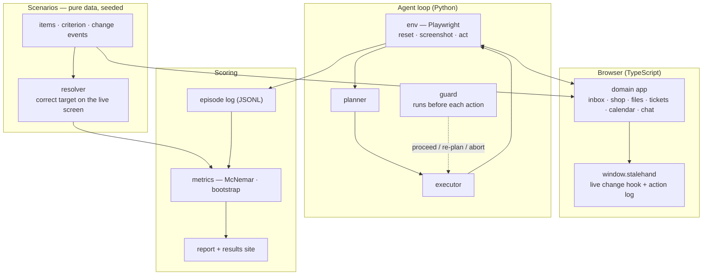
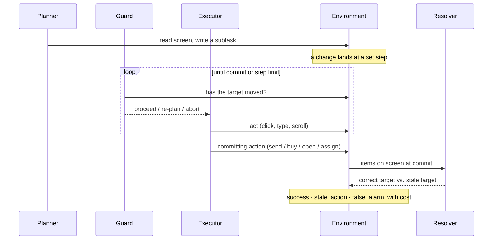

# StaleHand

**A reproducible test suite for stale-subtask handoffs in hierarchical computer-use agents — and a fair comparison of the guards that prevent them.**

[](.github/workflows/)
[](pyproject.toml)
[](crates/)
[](runner/go.mod)
[](apps/package.json)
[](LICENSE)

A planner writes a subtask from one screen; an executor carries it out while the
screen keeps changing. StaleHand measures how often the executor acts on what the
planner saw instead of what is on screen now, and compares the guards that stop it —
on synthetic apps you own, with ground truth that is computed, never hand-labelled.

> Asked to *"forward the latest email from Samuel Lee"*, the planner writes *"open
> the email titled Venue booking for the offsite."* A newer email from Samuel Lee
> arrives. The executor follows the subject line and opens the old one.

---

## Contents

| Section | |
|---|---|
| [What it does](#what-it-does) | The capability surface, by area |
| [Architecture](#architecture) | How the pieces fit |
| [How an episode runs](#how-an-episode-runs) | Plan, guard, act, change, score |
| [Quick start](#quick-start) | From a clean checkout to a run |
| [Project status](#project-status) | Every phase, all complete |
| [Results](#results) | Read from `results/`, never typed by hand |
| [Design decisions](#design-decisions) | The tradeoffs, and why |
| [Repository layout](#repository-layout) | Where things live |
| [Documentation](#documentation) | Which file answers which question |
| [Team](#team) | Who built it |

---

## What it does

| Area | Capabilities |
|---|---|
| **Scenarios** | Deterministic items, a selection criterion (fixed target or a relative reference like *latest* / *cheapest*), change events, and a resolver that computes the correct target from the items on screen |
| **Domains** | Six synthetic apps — inbox, shop, files, tickets, calendar, chat — each with new-item, re-sort, value-update, target-removed and cosmetic changes |
| **Environment** | A Playwright harness: reset, screenshot, act, apply a change at a set step, track DOM mutations; a static render mode for cheap before/after figures |
| **Agents** | Three architectures — hierarchical (planner + worker), delegated (orchestrator + GUI operator with a step budget), and flat (one policy per step, as a reference) |
| **Guards** | none, re-plan every step, self-check, rule subtask, DOM abort / re-plan, pixel-diff abort, and target re-binding — run before every executor action |
| **Metrics** | Per-episode outcomes and paired statistics: exact McNemar and a cluster bootstrap over scenario templates |
| **Runner** | A Go orchestrator that expands a matrix, shards it across GPU boxes over ssh, records full provenance in SQLite, and resumes after a crash |
| **Reports** | A report builder and a static results explorer that read and validate the result JSONL — no number is ever written by hand |

---

## Architecture

Pure-data scenarios drive a browser app; the agent loop reads screenshots and acts
through a Playwright environment, with a guard running before each action. Every
episode is logged, then scored against ground truth the resolver computes.



The crate `screendiff` (Rust) powers the pixel guard — SSIM per step must take
milliseconds — and `stalestats` (Rust) runs the cluster bootstrap. Both are
cross-checked against the Python implementations on shared fixtures.

---

## How an episode runs



A change is **relevant** exactly when the resolver's answer on the committing screen
differs from its answer on the screen the planner saw — computed from the data, so
no outcome is hand-labelled.

---

## Quick start

```bash
# 1 — environment
python -m venv .venv
.venv/bin/pip install -e ".[dev,render,stats]"
.venv/bin/pytest

# 2 — generate scenarios as JSONL
.venv/bin/stalehand scenarios --domain inbox --count 20 > inbox.jsonl

# 3 — render a scenario's before/after screens (no model needed)
.venv/bin/stalehand render --domain inbox --index 0

# 4 — build the web apps
cd apps && npm ci && npm run build && cd ..

# 5 — a report from result files, and refresh the README numbers
.venv/bin/stalehand report results/vivian-4090/main
.venv/bin/stalehand readme
```

> Running a full matrix on GPU boxes uses the Go runner in [runner/](runner/); see
> [docs/usage.md](docs/usage.md) for serving models and dispatching a run.

---

## Project status

All ten phases are complete: every component has tests passing, and the one
remaining analysis item (why files and tickets floor under every guard) is closed in
[docs/progress.md](docs/progress.md).

```mermaid
gantt
    title Delivery — all phases complete
    dateFormat X
    axisFormat %s
    section Foundation
    Phase 1 · shared schemas            :done, 0, 1
    Phase 2 · scenario core             :done, 1, 2
    section Environment
    Phase 3 · web apps and env          :done, 2, 3
    Phase 4 · models and agents         :done, 3, 4
    section Method
    Phase 5 · guards                    :done, 4, 5
    Phase 6 · metrics and statistics    :done, 5, 6
    Phase 7 · runner                    :done, 6, 7
    section Scale
    Phase 8 · more domains              :done, 7, 8
    Phase 9 · experiments               :done, 8, 9
    Phase 10 · reports, docs, release   :done, 9, 10
```



| Phase | Scope | Status |
|---|---|:---:|
| 1 | Shared JSON Schemas and cross-language fixtures | ✅ |
| 2 | Scenario core: items, criteria, resolver, change events | ✅ |
| 3 | Web apps, Playwright environment, handoff change timing, static render | ✅ |
| 4 | Model backends, hierarchical / delegated / flat agents, serving scripts | ✅ |
| 5 | Guards: re-plan, self-check, rule subtask, DOM, pixel, rebind | ✅ |
| 6 | Outcome scoring, exact McNemar, cluster bootstrap (`stalestats` crate) | ✅ |
| 7 | Go runner: matrix, SQLite store, ssh dispatch, resume, provenance | ✅ |
| 8 | Four more domains: files, tickets, calendar, chat | ✅ |
| 9 | Experiments: main, timing, stall, delegated, flat, small-planner, domains | ✅ |
| 10 | Report builder, contrasts, results site, final report, docs, license | ✅ |

---

## Results

Every number below is read from `results/` by `stalehand readme`; CI checks it is current.

<!-- results:start (generated by `stalehand readme`; do not edit) -->
Built from 8054 scored episodes under `results/`. Rates are per episode; planner calls and model seconds are means per episode. Paired comparisons with confidence intervals are in the full report (`stalehand report`).

### `vivian-4090/delegated`

Executor: ui-tars-1.5-7b.

| guard | episodes | successes | success rate | stale rate on relevant changes | false alarms on harmless changes | planner calls | model seconds |
|---|---|---|---|---|---|---|---|
| dom_subtask_replan | 205 | 138 | 67% | 2% | 76% | 3.5 | 96.9 |
| none | 205 | 109 | 53% | 42% | 0% | 2.7 | 87.9 |
| rebind_dom | 205 | 129 | 63% | 0% | 16% | 2.4 | 99.6 |
| replan_every_step | 205 | 154 | 75% | 2% | 100% | 7.5 | 150.9 |

### `vivian-4090/domains`

Executor: ui-tars-1.5-7b.

| guard | episodes | successes | success rate | stale rate on relevant changes | false alarms on harmless changes | planner calls | model seconds |
|---|---|---|---|---|---|---|---|
| dom_subtask_replan | 240 | 61 | 25% | 0% | 76% | 2.4 | 169.7 |
| none | 240 | 44 | 18% | 8% | 0% | 1.5 | 170.9 |
| replan_every_step | 240 | 69 | 29% | 0% | 100% | 10.8 | 183.8 |
| rebind_step | 240 | 42 | 18% | 10% | 39% | 2.0 | 202.2 |
| pixel_0.02_replan | 240 | 60 | 25% | 16% | 96% | 3.0 | 165.7 |
| rebind_dom | 240 | 47 | 20% | 10% | 29% | 1.6 | 173.5 |
| rule_subtask | 240 | 32 | 13% | 6% | 0% | 1.4 | 179.0 |
| self_check | 240 | 50 | 21% | 10% | 41% | 3.1 | 204.3 |

### `vivian-4090/domains_lab`

Executor: ui-tars-1.5-7b.

| guard | episodes | successes | success rate | stale rate on relevant changes | false alarms on harmless changes | planner calls | model seconds |
|---|---|---|---|---|---|---|---|
| none | 97 | 17 | 18% | 5% | 0% | 1.6 | 118.1 |
| replan_every_step | 87 | 31 | 36% | 0% | 100% | 10.3 | 145.2 |
| rebind_dom | 70 | 23 | 33% | 10% | 30% | 1.7 | 105.8 |

### `vivian-4090/flat`

Executor: ui-tars-1.5-7b.

| guard | episodes | successes | success rate | stale rate on relevant changes | false alarms on harmless changes | planner calls | model seconds |
|---|---|---|---|---|---|---|---|
| none | 205 | 108 | 53% | 13% | 0% | 0.0 | 86.0 |

### `vivian-4090/flat_internvl`

Executor: internvl3.5-8b.

| guard | episodes | successes | success rate | stale rate on relevant changes | false alarms on harmless changes | planner calls | model seconds |
|---|---|---|---|---|---|---|---|
| none | 205 | 44 | 21% | 7% | 0% | 0.0 | 190.2 |

### `vivian-4090/main`

Executor: ui-tars-1.5-7b.

| guard | episodes | successes | success rate | stale rate on relevant changes | false alarms on harmless changes | planner calls | model seconds |
|---|---|---|---|---|---|---|---|
| replan_every_step | 205 | 155 | 76% | 0% | 100% | 7.5 | 91.5 |
| rebind_step | 205 | 120 | 59% | 0% | 62% | 2.2 | 138.7 |
| pixel_0.02_replan | 205 | 135 | 66% | 4% | 100% | 5.1 | 93.3 |
| rebind_dom | 205 | 128 | 62% | 2% | 15% | 1.9 | 96.1 |
| self_check | 205 | 119 | 58% | 18% | 25% | 2.8 | 115.2 |
| rule_subtask | 205 | 88 | 43% | 5% | 0% | 1.7 | 96.6 |
| none | 205 | 102 | 50% | 44% | 0% | 2.3 | 74.6 |
| dom_subtask_replan | 205 | 129 | 63% | 0% | 76% | 3.1 | 81.8 |

### `vivian-4090/main_stall`

Executor: ui-tars-1.5-7b.

| guard | episodes | successes | success rate | stale rate on relevant changes | false alarms on harmless changes | planner calls | model seconds |
|---|---|---|---|---|---|---|---|
| rebind_dom | 205 | 151 | 74% | 7% | 14% | 3.5 | 129.9 |
| replan_every_step | 205 | 164 | 80% | 0% | 100% | 7.5 | 198.9 |
| none | 205 | 118 | 58% | 53% | 0% | 3.1 | 99.6 |

### `vivian-4090/pilot`

Executor: ui-tars-1.5-7b.

| guard | episodes | successes | success rate | stale rate on relevant changes | false alarms on harmless changes | planner calls | model seconds |
|---|---|---|---|---|---|---|---|
| replan_every_step | 205 | 111 | 54% | 16% | 100% | 7.8 | 94.2 |
| none | 205 | 88 | 43% | 25% | 0% | 1.9 | 86.1 |

### `vivian-4090/pilot_shop_rerun`

Executor: ui-tars-1.5-7b.

| guard | episodes | successes | success rate | stale rate on relevant changes | false alarms on harmless changes | planner calls | model seconds |
|---|---|---|---|---|---|---|---|
| replan_every_step | 70 | 29 | 41% | 40% | 100% | 3.2 | 32.3 |
| none | 70 | 18 | 26% | 34% | 0% | 2.3 | 68.5 |

### `vivian-4090/small_planner`

Executor: ui-tars-1.5-7b.

| guard | episodes | successes | success rate | stale rate on relevant changes | false alarms on harmless changes | planner calls | model seconds |
|---|---|---|---|---|---|---|---|
| rebind_dom | 205 | 102 | 50% | 7% | 48% | 1.9 | 137.7 |
| none | 205 | 83 | 40% | 38% | 0% | 2.0 | 148.7 |
| replan_every_step | 205 | 141 | 69% | 7% | 100% | 12.2 | 185.5 |
| dom_subtask_replan | 205 | 108 | 53% | 4% | 76% | 2.9 | 151.1 |

### `vivian-4090/timing`

Executor: ui-tars-1.5-7b.

| guard | episodes | successes | success rate | stale rate on relevant changes | false alarms on harmless changes | planner calls | model seconds |
|---|---|---|---|---|---|---|---|
| dom_step_abort | 205 | 23 | 11% | 0% | 76% | 1.2 | 26.8 |
| dom_step_replan | 205 | 129 | 63% | 0% | 76% | 3.1 | 94.2 |
| none | 205 | 91 | 44% | 40% | 0% | 2.2 | 85.5 |
| rebind_step | 205 | 78 | 38% | 0% | 81% | 2.6 | 141.0 |
| dom_subtask_replan | 205 | 86 | 42% | 4% | 76% | 3.2 | 90.3 |
<!-- results:end -->

## Design decisions

**Synthetic apps, not a real application.** Owning the apps is what buys a
`window.stalehand` hook to apply a change at an exact step, computed ground truth
from items as data, and full determinism from a seed. A real mail client would cost
all three and add a scraper per app and version. The reasoning, and the minimal path
to a real-app validation subset, are in [docs/design.md](docs/design.md).

**Ground truth is computed, never hand-labelled.** A task is a criterion plus an
ordering; the resolver applies it to the items on screen at the committing action. A
change is relevant exactly when the planner's screen and the commit screen resolve to
different targets. Scoring cannot drift from the data.

**One language per part, meeting at JSON.** Python for agents and analysis, TypeScript
for the browser apps and their multi-step flows, Go for the crash-resumable run
orchestrator, Rust for the millisecond pixel diff and the bootstrap. They share only
the schemas in `schema/`, checked from every language.

**Guards are compared, not advocated.** Every guard runs on the same scenarios,
models and decoding settings, and is charged for its false alarms on harmless changes
and its extra planner calls and seconds — not only its catch rate.

**Negative results are kept.** Floor effects, dropped model families and failed runs
are recorded in [docs/progress.md](docs/progress.md), not quietly dropped.

---

## Repository layout

```
.
├── schema/        JSON Schemas for scenarios, episodes and results, plus shared fixtures
├── src/stalehand/ scenarios, env, models, agents, guards, metrics, report, run, CLI (Python)
├── apps/          one TypeScript web app per domain, the change hook and the action log
├── crates/        screendiff (pixel diff / SSIM) and stalestats (cluster bootstrap), in Rust
├── runner/        the Go run orchestrator: matrix, SQLite store, ssh dispatch, resume
├── site/          static results explorer that reads and validates result JSONL
├── experiments/   run matrices and analysis scripts
├── results/       scored run sets, each with its config, seed and library versions
├── scripts/       machine setup and model serving (lab boxes, Ada)
├── examples/      one scenario, end to end
└── docs/          design, usage, worked examples, progress and the report template
```

---

## Documentation

| Question | File |
|---|---|
| *How is it designed, and why?* | [docs/design.md](docs/design.md) |
| *How do I run it end to end?* | [docs/usage.md](docs/usage.md) |
| *Show me a worked example* | [docs/examples.md](docs/examples.md), [examples/](examples/) |
| *What failed, was skipped or is blocked?* | [docs/progress.md](docs/progress.md) |
| *What does the final report look like?* | [docs/report_template.md](docs/report_template.md) |
| *What are the results?* | [results/REPORT.md](results/REPORT.md) |

---

## Team

| Member | Focus |
|---|---|
| **Guru R Bharadwaj** | New domains (files, tickets, calendar, chat), Rust statistics, results site and final report, model serving, docs |
| **Vivian Sobers** | Scenario core, web apps and Playwright environment, agents, guards, Go runner, experiments |

Work runs on two tracks that meet only at the schemas, the page API, and the model
and guard interfaces. A feature is finished only when both halves exist.

---

## License

[MIT](LICENSE).
