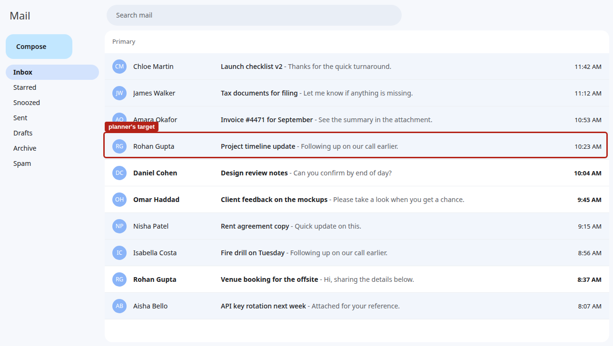
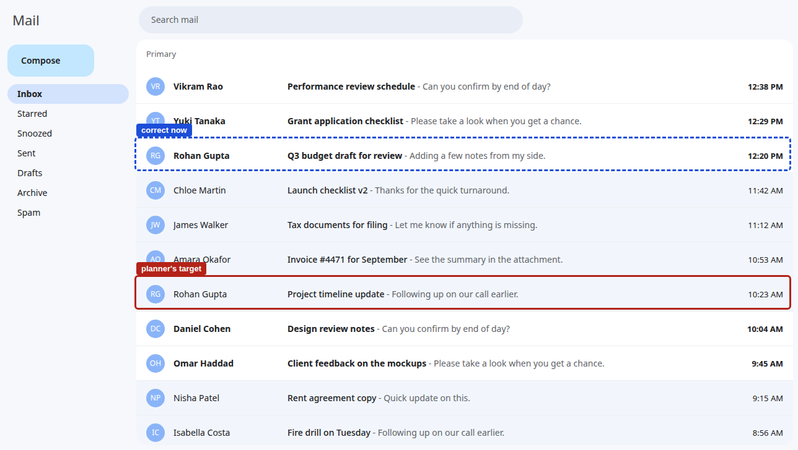
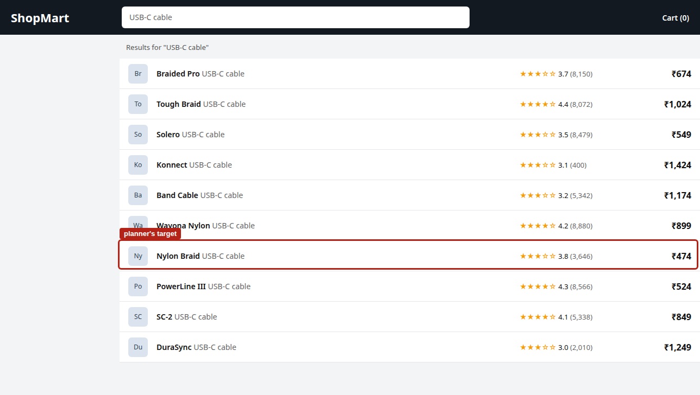
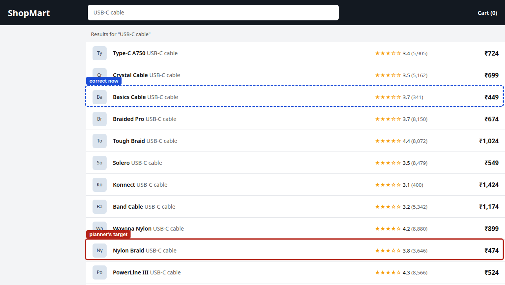

# StaleHand results

<!-- Rendered by `stalehand final` from docs/report_template.md. Edit the template, not results/REPORT.md.
Every number below is filled in from result files; the tables it links to are generated the same way. -->

All runs used Qwen3-VL-8B as planner and UI-TARS-1.5-7B as executor, in bf16 on two lab RTX 4090s, with greedy
decoding and seed 0. Each run directory holds the job, model revisions, git commit and library versions in
`config.json`. Intervals are 95% bootstrap intervals over scenario templates. p-values are exact McNemar tests on
paired episodes, Holm-adjusted within each family of comparisons.

## A subtask written before a change goes stale

In the main comparison (1640 episodes on the inbox and the shop), the planner writes a subtask from
one screen and the page changes before the executor looks at it. With no guard, the agent completed
4% of the 55 episodes whose change moved or removed the planner's
target, and acted on the stale target in 44% of them. On the 145
episodes where nothing relevant changed, the same agent succeeded 69% of the time.

| What the planner saw | What the executor saw |
|---|---|
|  |  |
|  |  |

Two of the main scenarios, drawn with `stalehand render`. Task: reply to the most recent email from Rohan Gupta. A
newer one arrives after the planner has picked the older one. Task: add the cheapest USB-C cable to the cart. The
listing changes and a cheaper cable appears.

## Every guard helps, at different costs

Paired on the same relevant-change scenarios, every guard beat no guard (`results/vivian-4090/main_report.md`,
"Paired against `none`"). They differ in how often they fire when nothing relevant changed, and in how many model
calls they add.

- **Re-planning at every step** had the highest success on relevant changes,
  80% (+76 pts over no guard,
  [+62, +90]). It fires on every step by design, so its false-alarm rate is
  100%, and it made 7.5 planner and checker calls
  per episode against 2.3 for no guard.
- **Re-binding on a DOM change** (`rebind_dom`) reached 55%
  (+51 pts, [+33, +68]) with 2.8 calls per
  episode. It fired on 15% of harmless changes, the lowest of the guards that watch the
  page, and kept success on harmless episodes at 68%. It fired on
  91% of the relevant changes, so it usually noticed them; many of its failures
  after that were the click loops described next.
- **Re-planning on a DOM change** (`dom_subtask_replan`) did about as well on relevant changes,
  58%, but fired on 76% of harmless
  changes, because any DOM change triggers it.
- **The pixel guard** fired on 100% of harmless changes. At the handoff it can't
  tell a harmless change from a relevant one, which matches the model-free calibration in
  `results/vivian-4090/checks_report.md`. It works as an expensive version of re-planning every step.
- **Self-check** reached 36% at 9.2 calls per episode.
- **Rule subtasks** gained the least, 27% on relevant changes, and lowered
  success on harmless ones to 50%. Writing the subtask as a rule seems to make
  the executor's job harder even when nothing changes.

## A confound: the executor gets stuck clicking one spot

With no guard, 63% of the episodes that ended without committing were click loops:
the episode ran out of steps while the executor clicked the same spot (`results/vivian-4090/loops_report.md`).
Usually the click had already worked. The page moved on, and the executor kept clicking a label that looks like the
button it was told to press. A plain hierarchical executor only hands control back when it says it is finished, so
the planner never sees the new screen. Re-planning at every step asks the planner at every step anyway, and its
episodes were click loops 5% of the time, against 19% with
no guard. Part of its lead over the cheaper guards may therefore come from breaking loops rather than from catching
stale subtasks. `docs/progress.md` has the details.

## When the change lands mid-step, only a check right before the click helps

The timing study (1025 episodes) reruns the main scenarios with the change landing between the
executor's screenshot and its click, the time-of-check to time-of-use window. The executor then clicks a position
taken from a screen that no longer exists.

The click usually lands on the wrong item, whether or not the change mattered to the task. On harmless changes,
the first item the agent opened was the wrong one in 72% of episodes with no guard,
against 10% when the same change landed at the handoff
(`results/vivian-4090/recovery_report.md`). That matches the model-free click-hazard audit in
`results/vivian-4090/checks_report.md`.

What a guard can do about it depends on when it looks:

- **A DOM check just before the action** (`dom_step_replan`) sees the change before the click and re-plans. Its
  first-open misses stayed at 10%, and it reached
  56% on relevant changes (+51 pts over no
  guard, [+34, +68]) and 68% on harmless ones.
- **A guard that checks only before the executor's next thought** comes in after the wrong click. Paired against
  the same guard under the handoff timing, `dom_subtask_replan` changed by -27 pts
  ([-43, -12]) on relevant changes and -19 pts
  ([-29, -10]) on harmless ones, and `rebind_step` by
  -27 pts and -19 pts. No guard changed by only
  -8 pts on harmless changes, so on those these guards did worse than having none. The miss
  itself is the same: the first opened item was wrong in 72% of
  harmless episodes with `dom_subtask_replan`, as with no guard. The difference is recovery. After a missed first
  click, no guard went on to succeed in 53% of episodes and committed to a wrong item in
  14%; `dom_subtask_replan` succeeded in 35% and
  committed to a wrong item in 42%. In one trace we read in full, the
  re-plan starts from the wrong email's screen, and the new subtask ('Click the "Back to Inbox" button to return
  to the inbox and locate the email from Amara Okafor') has dropped the subject line that told the two emails
  apart. We have not checked how often that is the cause.
- **Aborting on any DOM change** (`dom_step_abort`) is a clean negative. It never acts on a stale target, but it
  succeeded on 0% of relevant changes and
  16% of harmless ones, because nearly every episode sees some change.

Paired tables: `results/vivian-4090/contrasts_report.md` and `results/vivian-4090/timing_report.md`.

## Breaking executor loops closes most of the gap

The stall-return ablation (615 episodes) reruns three guards on the main scenarios with one
change to the agent: after two actions in a row that leave the screenshot unchanged, the executor hands control back
to the planner (architecture `hierarchical_stall`). The apps and scenarios are untouched, so every episode pairs
with its counterpart in the main comparison. A model-free check found no scenario whose correct flow would trip the
stall return (`results/vivian-4090/checks_report.md`).

- **`rebind_dom`** gained the most. On relevant changes it went from 55% to
  75% (+20 pts,
  [+9, +31], Holm p = 0.024). Its click loops fell
  from 41% to 10% of episodes. The extra planner calls
  after a stall raised its cost from 2.8 to 4.3 calls per
  episode. Its false alarms were 14% of harmless changes, against
  15% before.
- **Re-planning at every step** had little to gain, since it already escaped loops: 80%
  to 84% on relevant changes (+4 pts,
  [-5, +15]), still at 7.5 calls per episode.
- **No guard** did better on harmless changes, 69% to 78%
  (+9 pts, [+1, +19], Holm p = 0.054),
  but the stall return does nothing about staleness: it acted on the stale target in
  53% of relevant changes.

With loops broken, `rebind_dom` reached 75% on relevant changes against
84% for re-planning at every step, at 4.3
calls per episode instead of 7.5, and with false alarms on
14% of harmless changes instead of all of them. We did not test the difference
between those two guards directly. In the main comparison, part of re-planning's lead came from loop escape.

## Delegating whole goals changes little

In the delegated architecture (820 episodes) the orchestrator hands over a goal, and the operator
works on it alone for up to eight actions before reporting back. Paired with the hierarchical agent on the same
guard and scenarios, no difference survived the Holm adjustment (`results/vivian-4090/contrasts_report.md`). The
stale handoff is just as present: with no guard, the delegated agent succeeded on 15%
of relevant changes and acted on the stale target in 42%. The guards help about as much
as before. `rebind_dom` gained +53 pts over no guard ([+40, +66])
and re-planning at every step +60 pts ([+47, +73]).
The operator's step budget also hands control back on its own, and click loops were rarer: 1%
of episodes with no guard, against 19% for the hierarchical agent.

## Without a planner, there is no stale subtask to follow

The flat reference (205 episodes) runs UI-TARS alone on the main scenarios: no planner and no guard.
It reads the task itself at every step, so no subtask can go stale. On relevant changes it succeeded
33% of the time and acted on the stale target in 13% of them,
against 4% and 44% for the hierarchical agent with no guard
(+29 pts, [+11, +45], Holm p = 0.012).

The timings are not quite matched. A flat agent has no handoff, so the change lands just before its first action,
which is what the mid-step timing does to the hierarchical agent. Its first-open misses on harmless changes,
74%, match the mid-step run's 72%. Against that timing the
gap is about the same: the hierarchical agent with no guard succeeded on 5% of
relevant changes and 61% of harmless ones, the flat agent on
33% and 62%. The guarded hierarchical agents still did better
than the flat one on relevant changes, as the main and stall sections show.

## New domains: incomplete

The three-guard run on files, tickets, calendar and chat stopped partway. At 05:40 another team's jobs took the lab
GPUs and our model servers stopped, and the planner's Python environment on worker-2 was removed. The
254 episodes that finished are in `results/vivian-4090/domains_lab_report.md`. Only
2 relevant-change scenarios finished under both `rebind_dom` and no guard,
and 11 under re-planning at every step and no guard, so this report
draws no conclusion about guards from them. They do show that these domains are harder for this agent: with no
guard it succeeded on 25% of harmless changes, against
69% on the inbox and the shop.

## Not run yet

- The rest of the new-domain run, once the lab GPUs are free (`runs/domains_lab.db` on worker-1 holds its state).
- The second model family (InternVL3.5), the small-planner arm (Qwen3-VL-4B) and the eight-guard comparison on
  the new domains. Their matrices are in `experiments/second_family/`, `experiments/small_planner/` and
  `experiments/domains/`; since 2 October they run on the lab boxes (`CONTRIBUTING.md`).
