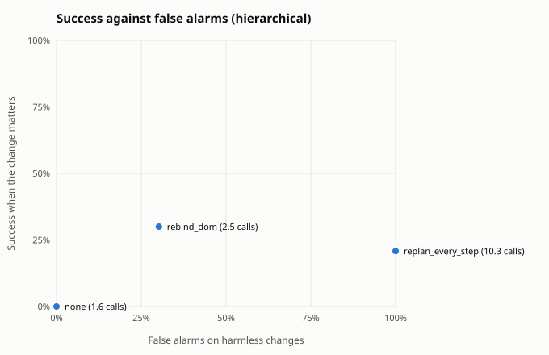
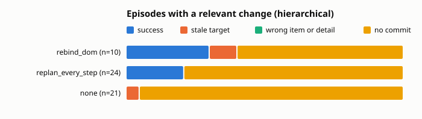

Built from 254 scored episodes.

## Summary by guard

Relevant: the change moved or removed the target the planner saw. Harmless: no change, or one that leaves the target where it was. Fired: the guard re-planned, re-bound or aborted at least once. Calls: planner plus checker calls per episode.

| architecture | guard | relevant n | fired | success | stale | harmless n | success | false alarms | calls |
|---|---|---|---|---|---|---|---|---|---|
| hierarchical | none | 21 | 0% | 0% | 5% | 69 | 25% | 0% | 1.6 |
| hierarchical | replan_every_step | 24 | 100% | 21% | 0% | 57 | 46% | 100% | 10.3 |
| hierarchical | rebind_dom | 10 | 80% | 30% | 10% | 53 | 38% | 30% | 2.5 |

## By change kind

Success on each kind of change. When the change removed the target there is no correct item, so the column counts episodes that held off: no commit, or a guard abort.

| architecture | guard | no change | irrelevant | relevant | target removed: held off |
|---|---|---|---|---|---|
| hierarchical | none | 28% of 36 | 21% of 33 | 0% of 21 | 100% of 7 |
| hierarchical | replan_every_step | 46% of 26 | 45% of 31 | 21% of 24 | 100% of 6 |
| hierarchical | rebind_dom | 38% of 24 | 38% of 29 | 30% of 10 | 100% of 7 |

## Relevant changes by task

Success on episodes whose change moved the target, per task.

| architecture | guard | calendar relative | chat relative | files relative | tickets relative |
|---|---|---|---|---|---|
| hierarchical | none | 0% of 5 | 0% of 5 | 0% of 3 | 0% of 8 |
| hierarchical | replan_every_step | 100% of 4 | 10% of 10 | 0% of 4 | 0% of 6 |
| hierarchical | rebind_dom | 75% of 4 | 0% of 2 | 0% of 4 | n/a |

## Outcomes

| architecture | guard | domain | kind | change | n | success | stale | wrong_item | wrong_detail | aborted | no_commit | planner calls |
|---|---|---|---|---|---|---|---|---|---|---|---|---|
| hierarchical | none | calendar | fixed | irrelevant | 9 | 67% | 0% | 0% | 0% | 0% | 33% | 1.7 |
| hierarchical | none | calendar | fixed | none | 8 | 75% | 0% | 0% | 0% | 0% | 25% | 1.6 |
| hierarchical | none | calendar | fixed | target_removed | 3 | 0% | 0% | 0% | 0% | 0% | 100% | 1.0 |
| hierarchical | none | calendar | relative | irrelevant | 1 | 100% | 0% | 0% | 0% | 0% | 0% | 2.0 |
| hierarchical | none | calendar | relative | none | 4 | 100% | 0% | 0% | 0% | 0% | 0% | 2.0 |
| hierarchical | none | calendar | relative | relevant | 5 | 0% | 20% | 0% | 0% | 0% | 80% | 1.2 |
| hierarchical | none | chat | fixed | irrelevant | 3 | 0% | 0% | 0% | 0% | 0% | 100% | 1.0 |
| hierarchical | none | chat | fixed | none | 2 | 0% | 0% | 0% | 0% | 0% | 100% | 1.0 |
| hierarchical | none | chat | fixed | target_removed | 1 | 0% | 0% | 0% | 0% | 0% | 100% | 1.0 |
| hierarchical | none | chat | relative | irrelevant | 5 | 0% | 0% | 0% | 0% | 0% | 100% | 1.0 |
| hierarchical | none | chat | relative | none | 7 | 0% | 0% | 0% | 0% | 0% | 100% | 1.1 |
| hierarchical | none | chat | relative | relevant | 5 | 0% | 0% | 0% | 0% | 0% | 100% | 1.0 |
| hierarchical | none | files | relative | irrelevant | 3 | 0% | 0% | 0% | 0% | 0% | 100% | 1.0 |
| hierarchical | none | files | relative | none | 3 | 0% | 0% | 0% | 0% | 0% | 100% | 1.0 |
| hierarchical | none | files | relative | relevant | 3 | 0% | 0% | 0% | 0% | 0% | 100% | 4.3 |
| hierarchical | none | tickets | fixed | irrelevant | 9 | 0% | 0% | 0% | 33% | 0% | 67% | 2.7 |
| hierarchical | none | tickets | fixed | none | 8 | 0% | 0% | 0% | 25% | 0% | 75% | 2.6 |
| hierarchical | none | tickets | fixed | target_removed | 3 | 0% | 0% | 0% | 0% | 0% | 100% | 1.7 |
| hierarchical | none | tickets | relative | irrelevant | 3 | 0% | 0% | 0% | 0% | 0% | 100% | 1.0 |
| hierarchical | none | tickets | relative | none | 4 | 0% | 0% | 0% | 0% | 0% | 100% | 1.0 |
| hierarchical | none | tickets | relative | relevant | 8 | 0% | 0% | 0% | 0% | 0% | 100% | 1.0 |
| hierarchical | rebind_dom | calendar | fixed | irrelevant | 9 | 100% | 0% | 0% | 0% | 0% | 0% | 2.1 |
| hierarchical | rebind_dom | calendar | fixed | none | 8 | 100% | 0% | 0% | 0% | 0% | 0% | 2.1 |
| hierarchical | rebind_dom | calendar | fixed | target_removed | 3 | 0% | 0% | 0% | 0% | 0% | 100% | 2.0 |
| hierarchical | rebind_dom | calendar | relative | irrelevant | 2 | 100% | 0% | 0% | 0% | 0% | 0% | 2.0 |
| hierarchical | rebind_dom | calendar | relative | none | 4 | 25% | 0% | 50% | 0% | 0% | 25% | 1.8 |
| hierarchical | rebind_dom | calendar | relative | relevant | 4 | 75% | 25% | 0% | 0% | 0% | 0% | 2.0 |
| hierarchical | rebind_dom | chat | relative | irrelevant | 2 | 0% | 0% | 0% | 0% | 0% | 100% | 1.0 |
| hierarchical | rebind_dom | chat | relative | none | 3 | 0% | 0% | 0% | 0% | 0% | 100% | 1.0 |
| hierarchical | rebind_dom | chat | relative | relevant | 2 | 0% | 0% | 0% | 0% | 0% | 100% | 1.0 |
| hierarchical | rebind_dom | files | fixed | irrelevant | 3 | 0% | 0% | 0% | 0% | 0% | 100% | 1.0 |
| hierarchical | rebind_dom | files | fixed | none | 3 | 0% | 0% | 0% | 0% | 0% | 100% | 1.7 |
| hierarchical | rebind_dom | files | fixed | target_removed | 1 | 0% | 0% | 0% | 0% | 0% | 100% | 2.0 |
| hierarchical | rebind_dom | files | relative | irrelevant | 4 | 0% | 0% | 0% | 0% | 0% | 100% | 1.0 |
| hierarchical | rebind_dom | files | relative | none | 2 | 0% | 0% | 0% | 0% | 0% | 100% | 1.0 |
| hierarchical | rebind_dom | files | relative | relevant | 4 | 0% | 0% | 0% | 0% | 0% | 100% | 1.0 |
| hierarchical | rebind_dom | tickets | fixed | irrelevant | 9 | 0% | 0% | 0% | 0% | 0% | 100% | 2.0 |
| hierarchical | rebind_dom | tickets | fixed | none | 4 | 0% | 0% | 0% | 0% | 0% | 100% | 2.0 |
| hierarchical | rebind_dom | tickets | fixed | target_removed | 3 | 0% | 0% | 0% | 0% | 0% | 100% | 1.3 |
| hierarchical | replan_every_step | calendar | fixed | irrelevant | 10 | 100% | 0% | 0% | 0% | 0% | 0% | 4.0 |
| hierarchical | replan_every_step | calendar | fixed | none | 6 | 100% | 0% | 0% | 0% | 0% | 0% | 3.5 |
| hierarchical | replan_every_step | calendar | fixed | target_removed | 4 | 0% | 0% | 0% | 0% | 0% | 100% | 13.0 |
| hierarchical | replan_every_step | calendar | relative | irrelevant | 2 | 100% | 0% | 0% | 0% | 0% | 0% | 4.0 |
| hierarchical | replan_every_step | calendar | relative | none | 4 | 100% | 0% | 0% | 0% | 0% | 0% | 5.8 |
| hierarchical | replan_every_step | calendar | relative | relevant | 4 | 100% | 0% | 0% | 0% | 0% | 0% | 4.0 |
| hierarchical | replan_every_step | chat | fixed | irrelevant | 4 | 0% | 0% | 0% | 0% | 0% | 100% | 13.0 |
| hierarchical | replan_every_step | chat | fixed | none | 4 | 25% | 0% | 0% | 0% | 0% | 75% | 12.5 |
| hierarchical | replan_every_step | chat | fixed | target_removed | 2 | 0% | 0% | 0% | 0% | 0% | 100% | 13.0 |
| hierarchical | replan_every_step | chat | relative | irrelevant | 10 | 20% | 0% | 0% | 0% | 0% | 80% | 13.0 |
| hierarchical | replan_every_step | chat | relative | none | 8 | 12% | 0% | 12% | 0% | 0% | 75% | 12.5 |
| hierarchical | replan_every_step | chat | relative | relevant | 10 | 10% | 0% | 0% | 0% | 0% | 90% | 13.0 |
| hierarchical | replan_every_step | files | relative | irrelevant | 3 | 0% | 0% | 0% | 0% | 0% | 100% | 13.0 |
| hierarchical | replan_every_step | files | relative | none | 2 | 0% | 0% | 0% | 0% | 0% | 100% | 12.5 |
| hierarchical | replan_every_step | files | relative | relevant | 4 | 0% | 0% | 0% | 0% | 0% | 100% | 13.0 |
| hierarchical | replan_every_step | tickets | relative | irrelevant | 2 | 0% | 0% | 0% | 0% | 0% | 100% | 13.0 |
| hierarchical | replan_every_step | tickets | relative | none | 2 | 0% | 0% | 0% | 0% | 0% | 100% | 12.5 |
| hierarchical | replan_every_step | tickets | relative | relevant | 6 | 0% | 0% | 0% | 0% | 0% | 100% | 13.0 |

## Cost per episode

Means per episode. Model seconds add up the latency of every model call, so they include time spent waiting in a shared server's batch; compare them within one run set only.

| architecture | guard | planner calls | checker calls | executor calls | model seconds | actions |
|---|---|---|---|---|---|---|
| hierarchical | none | 1.6 | 0.0 | 11.1 | 118.1 | 10.5 |
| hierarchical | replan_every_step | 10.3 | 0.0 | 9.1 | 145.2 | 9.1 |
| hierarchical | rebind_dom | 1.7 | 0.8 | 9.3 | 105.8 | 8.7 |

## False alarms on harmless changes

| architecture | guard | harmless episodes | false alarm rate | planner calls |
|---|---|---|---|---|
| hierarchical | none | 69 | 0% | 1.6 |
| hierarchical | replan_every_step | 57 | 100% | 10.3 |
| hierarchical | rebind_dom | 53 | 30% | 1.7 |

## Paired against `none` on relevant changes

Same scenarios in both arms. Difference is the guard's success rate minus the baseline's, with a 95% bootstrap interval over scenario templates (10000 resamples, seed 0) and an exact McNemar test on the discordant pairs.

| architecture | guard | domain | pairs | none | guard | difference | 95% CI | only guard vs only baseline succeeded | McNemar |
|---|---|---|---|---|---|---|---|---|---|
| hierarchical | replan_every_step | chat | 5 | 0% | 20% | +20 pts | [+0, +50] | 1 vs 0 | p = 1.000 |
| hierarchical | replan_every_step | tickets | 6 | 0% | 0% | +0 pts | [+0, +0] | 0 vs 0 | p = 1.000 |
| hierarchical | replan_every_step | calendar | 0 | no shared scenarios yet |  |  |  |  |  |
| hierarchical | replan_every_step | files | 0 | no shared scenarios yet |  |  |  |  |  |
| hierarchical | replan_every_step | all | 11 | 0% | 9% | +9 pts | [+0, +30] | 1 vs 0 | p = 1.000 |
| hierarchical | rebind_dom | chat | 2 | 0% | 0% | +0 pts | [+0, +0] | 0 vs 0 | p = 1.000 |
| hierarchical | rebind_dom | calendar | 0 | no shared scenarios yet |  |  |  |  |  |
| hierarchical | rebind_dom | files | 0 | no shared scenarios yet |  |  |  |  |  |
| hierarchical | rebind_dom | all | 2 | 0% | 0% | +0 pts | [+0, +0] | 0 vs 0 | p = 1.000 |
