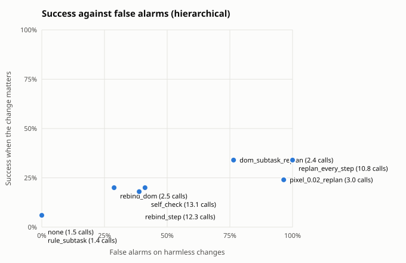
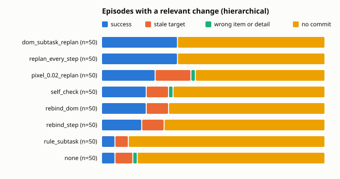

Built from 1920 scored episodes.

## Summary by guard

Relevant: the change moved or removed the target the planner saw. Harmless: no change, or one that leaves the target where it was. Fired: the guard re-planned, re-bound or aborted at least once. Calls: planner plus checker calls per episode.

| architecture | guard | relevant n | fired | success | stale | harmless n | success | false alarms | calls |
|---|---|---|---|---|---|---|---|---|---|
| hierarchical | dom_subtask_replan | 50 | 100% | 34% | 0% | 170 | 26% | 76% | 2.4 |
| hierarchical | none | 50 | 0% | 6% | 8% | 170 | 24% | 0% | 1.5 |
| hierarchical | replan_every_step | 50 | 100% | 34% | 0% | 170 | 31% | 100% | 10.8 |
| hierarchical | rebind_step | 50 | 92% | 18% | 10% | 170 | 19% | 39% | 12.3 |
| hierarchical | pixel_0.02_replan | 50 | 70% | 24% | 16% | 170 | 28% | 96% | 3.0 |
| hierarchical | rebind_dom | 50 | 86% | 20% | 10% | 170 | 22% | 29% | 2.5 |
| hierarchical | rule_subtask | 50 | 0% | 6% | 6% | 170 | 17% | 0% | 1.4 |
| hierarchical | self_check | 50 | 78% | 20% | 10% | 170 | 24% | 41% | 13.1 |

## By change kind

Success on each kind of change. When the change removed the target there is no correct item, so the column counts episodes that held off: no commit, or a guard abort.

| architecture | guard | no change | irrelevant | relevant | target removed: held off |
|---|---|---|---|---|---|
| hierarchical | dom_subtask_replan | 26% of 80 | 26% of 90 | 34% of 50 | 100% of 20 |
| hierarchical | none | 29% of 80 | 20% of 90 | 6% of 50 | 100% of 20 |
| hierarchical | replan_every_step | 29% of 80 | 32% of 90 | 34% of 50 | 100% of 20 |
| hierarchical | rebind_step | 19% of 80 | 20% of 90 | 18% of 50 | 100% of 20 |
| hierarchical | pixel_0.02_replan | 30% of 80 | 27% of 90 | 24% of 50 | 85% of 20 |
| hierarchical | rebind_dom | 20% of 80 | 23% of 90 | 20% of 50 | 100% of 20 |
| hierarchical | rule_subtask | 15% of 80 | 19% of 90 | 6% of 50 | 100% of 20 |
| hierarchical | self_check | 25% of 80 | 22% of 90 | 20% of 50 | 100% of 20 |

## Relevant changes by task

Success on episodes whose change moved the target, per task.

| architecture | guard | calendar relative | chat relative | files relative | tickets relative |
|---|---|---|---|---|---|
| hierarchical | dom_subtask_replan | 100% of 15 | 20% of 10 | 0% of 10 | 0% of 15 |
| hierarchical | none | 20% of 15 | 0% of 10 | 0% of 10 | 0% of 15 |
| hierarchical | replan_every_step | 100% of 15 | 20% of 10 | 0% of 10 | 0% of 15 |
| hierarchical | rebind_step | 53% of 15 | 10% of 10 | 0% of 10 | 0% of 15 |
| hierarchical | pixel_0.02_replan | 40% of 15 | 60% of 10 | 0% of 10 | 0% of 15 |
| hierarchical | rebind_dom | 60% of 15 | 10% of 10 | 0% of 10 | 0% of 15 |
| hierarchical | rule_subtask | 7% of 15 | 0% of 10 | 0% of 10 | 13% of 15 |
| hierarchical | self_check | 67% of 15 | 0% of 10 | 0% of 10 | 0% of 15 |

## Outcomes

| architecture | guard | domain | kind | change | n | success | stale | wrong_item | wrong_detail | aborted | no_commit | planner calls |
|---|---|---|---|---|---|---|---|---|---|---|---|---|
| hierarchical | none | calendar | fixed | irrelevant | 15 | 73% | 0% | 0% | 0% | 0% | 27% | 1.7 |
| hierarchical | none | calendar | fixed | none | 10 | 100% | 0% | 0% | 0% | 0% | 0% | 2.0 |
| hierarchical | none | calendar | fixed | target_removed | 5 | 0% | 0% | 0% | 0% | 0% | 100% | 1.0 |
| hierarchical | none | calendar | relative | irrelevant | 5 | 80% | 0% | 20% | 0% | 0% | 0% | 1.8 |
| hierarchical | none | calendar | relative | none | 10 | 80% | 0% | 20% | 0% | 0% | 0% | 2.0 |
| hierarchical | none | calendar | relative | relevant | 15 | 20% | 27% | 7% | 0% | 0% | 47% | 1.5 |
| hierarchical | none | chat | fixed | irrelevant | 15 | 20% | 0% | 0% | 0% | 0% | 80% | 1.7 |
| hierarchical | none | chat | fixed | none | 10 | 50% | 0% | 0% | 0% | 0% | 50% | 2.0 |
| hierarchical | none | chat | fixed | target_removed | 5 | 0% | 0% | 0% | 0% | 0% | 100% | 1.0 |
| hierarchical | none | chat | relative | irrelevant | 10 | 0% | 0% | 0% | 0% | 0% | 100% | 1.0 |
| hierarchical | none | chat | relative | none | 10 | 0% | 0% | 0% | 0% | 0% | 100% | 1.0 |
| hierarchical | none | chat | relative | relevant | 10 | 0% | 0% | 0% | 0% | 0% | 100% | 1.0 |
| hierarchical | none | files | fixed | irrelevant | 15 | 0% | 0% | 0% | 0% | 0% | 100% | 1.1 |
| hierarchical | none | files | fixed | none | 10 | 0% | 0% | 0% | 0% | 0% | 100% | 1.2 |
| hierarchical | none | files | fixed | target_removed | 5 | 0% | 0% | 0% | 0% | 0% | 100% | 1.2 |
| hierarchical | none | files | relative | irrelevant | 10 | 0% | 0% | 0% | 0% | 0% | 100% | 1.1 |
| hierarchical | none | files | relative | none | 10 | 0% | 0% | 0% | 0% | 0% | 100% | 1.0 |
| hierarchical | none | files | relative | relevant | 10 | 0% | 0% | 0% | 0% | 0% | 100% | 1.5 |
| hierarchical | none | tickets | fixed | irrelevant | 15 | 0% | 0% | 0% | 27% | 0% | 73% | 2.4 |
| hierarchical | none | tickets | fixed | none | 10 | 0% | 0% | 0% | 30% | 0% | 70% | 2.6 |
| hierarchical | none | tickets | fixed | target_removed | 5 | 0% | 0% | 0% | 0% | 0% | 100% | 1.2 |
| hierarchical | none | tickets | relative | irrelevant | 5 | 0% | 0% | 0% | 0% | 0% | 100% | 1.0 |
| hierarchical | none | tickets | relative | none | 10 | 0% | 0% | 0% | 0% | 0% | 100% | 1.0 |
| hierarchical | none | tickets | relative | relevant | 15 | 0% | 0% | 0% | 0% | 0% | 100% | 1.0 |
| hierarchical | dom_subtask_replan | calendar | fixed | irrelevant | 15 | 100% | 0% | 0% | 0% | 0% | 0% | 3.1 |
| hierarchical | dom_subtask_replan | calendar | fixed | none | 10 | 100% | 0% | 0% | 0% | 0% | 0% | 2.5 |
| hierarchical | dom_subtask_replan | calendar | fixed | target_removed | 5 | 0% | 0% | 0% | 0% | 0% | 100% | 2.0 |
| hierarchical | dom_subtask_replan | calendar | relative | irrelevant | 5 | 100% | 0% | 0% | 0% | 0% | 0% | 3.0 |
| hierarchical | dom_subtask_replan | calendar | relative | none | 10 | 90% | 0% | 10% | 0% | 0% | 0% | 2.4 |
| hierarchical | dom_subtask_replan | calendar | relative | relevant | 15 | 100% | 0% | 0% | 0% | 0% | 0% | 3.0 |
| hierarchical | dom_subtask_replan | chat | fixed | irrelevant | 15 | 20% | 0% | 0% | 0% | 0% | 80% | 2.7 |
| hierarchical | dom_subtask_replan | chat | fixed | none | 10 | 20% | 0% | 0% | 0% | 0% | 80% | 2.4 |
| hierarchical | dom_subtask_replan | chat | fixed | target_removed | 5 | 0% | 0% | 0% | 0% | 0% | 100% | 2.0 |
| hierarchical | dom_subtask_replan | chat | relative | irrelevant | 10 | 0% | 0% | 0% | 0% | 0% | 100% | 2.1 |
| hierarchical | dom_subtask_replan | chat | relative | none | 10 | 0% | 0% | 0% | 0% | 0% | 100% | 1.7 |
| hierarchical | dom_subtask_replan | chat | relative | relevant | 10 | 20% | 0% | 0% | 0% | 0% | 80% | 2.9 |
| hierarchical | dom_subtask_replan | files | fixed | irrelevant | 15 | 0% | 0% | 0% | 0% | 0% | 100% | 2.3 |
| hierarchical | dom_subtask_replan | files | fixed | none | 10 | 0% | 0% | 0% | 0% | 0% | 100% | 1.6 |
| hierarchical | dom_subtask_replan | files | fixed | target_removed | 5 | 0% | 0% | 0% | 0% | 0% | 100% | 2.6 |
| hierarchical | dom_subtask_replan | files | relative | irrelevant | 10 | 0% | 0% | 0% | 0% | 0% | 100% | 2.1 |
| hierarchical | dom_subtask_replan | files | relative | none | 10 | 0% | 0% | 0% | 0% | 0% | 100% | 1.5 |
| hierarchical | dom_subtask_replan | files | relative | relevant | 10 | 0% | 0% | 0% | 0% | 0% | 100% | 2.1 |
| hierarchical | dom_subtask_replan | tickets | fixed | irrelevant | 15 | 0% | 0% | 0% | 27% | 0% | 73% | 3.7 |
| hierarchical | dom_subtask_replan | tickets | fixed | none | 10 | 0% | 0% | 0% | 20% | 0% | 80% | 2.9 |
| hierarchical | dom_subtask_replan | tickets | fixed | target_removed | 5 | 0% | 0% | 0% | 0% | 0% | 100% | 2.6 |
| hierarchical | dom_subtask_replan | tickets | relative | irrelevant | 5 | 0% | 0% | 0% | 0% | 0% | 100% | 2.0 |
| hierarchical | dom_subtask_replan | tickets | relative | none | 10 | 0% | 0% | 0% | 0% | 0% | 100% | 1.5 |
| hierarchical | dom_subtask_replan | tickets | relative | relevant | 15 | 0% | 0% | 0% | 0% | 0% | 100% | 2.0 |
| hierarchical | pixel_0.02_replan | calendar | fixed | irrelevant | 15 | 100% | 0% | 0% | 0% | 0% | 0% | 3.1 |
| hierarchical | pixel_0.02_replan | calendar | fixed | none | 10 | 100% | 0% | 0% | 0% | 0% | 0% | 3.5 |
| hierarchical | pixel_0.02_replan | calendar | fixed | target_removed | 5 | 0% | 0% | 20% | 0% | 0% | 80% | 2.0 |
| hierarchical | pixel_0.02_replan | calendar | relative | irrelevant | 5 | 100% | 0% | 0% | 0% | 0% | 0% | 3.2 |
| hierarchical | pixel_0.02_replan | calendar | relative | none | 10 | 90% | 0% | 10% | 0% | 0% | 0% | 4.5 |
| hierarchical | pixel_0.02_replan | calendar | relative | relevant | 15 | 40% | 53% | 7% | 0% | 0% | 0% | 4.7 |
| hierarchical | pixel_0.02_replan | chat | fixed | irrelevant | 15 | 20% | 0% | 0% | 0% | 0% | 80% | 3.5 |
| hierarchical | pixel_0.02_replan | chat | fixed | none | 10 | 20% | 0% | 0% | 0% | 0% | 80% | 3.1 |
| hierarchical | pixel_0.02_replan | chat | fixed | target_removed | 5 | 0% | 0% | 0% | 0% | 0% | 100% | 2.2 |
| hierarchical | pixel_0.02_replan | chat | relative | irrelevant | 10 | 10% | 0% | 20% | 0% | 0% | 70% | 3.3 |
| hierarchical | pixel_0.02_replan | chat | relative | none | 10 | 30% | 0% | 10% | 0% | 0% | 60% | 3.6 |
| hierarchical | pixel_0.02_replan | chat | relative | relevant | 10 | 60% | 0% | 0% | 0% | 0% | 40% | 4.5 |
| hierarchical | pixel_0.02_replan | files | fixed | irrelevant | 15 | 0% | 0% | 0% | 0% | 0% | 100% | 3.0 |
| hierarchical | pixel_0.02_replan | files | fixed | none | 10 | 0% | 0% | 0% | 0% | 0% | 100% | 2.5 |
| hierarchical | pixel_0.02_replan | files | fixed | target_removed | 5 | 0% | 0% | 0% | 0% | 0% | 100% | 2.0 |
| hierarchical | pixel_0.02_replan | files | relative | irrelevant | 10 | 0% | 0% | 0% | 0% | 0% | 100% | 2.4 |
| hierarchical | pixel_0.02_replan | files | relative | none | 10 | 0% | 0% | 0% | 0% | 0% | 100% | 2.5 |
| hierarchical | pixel_0.02_replan | files | relative | relevant | 10 | 0% | 0% | 0% | 0% | 0% | 100% | 3.0 |
| hierarchical | pixel_0.02_replan | tickets | fixed | irrelevant | 15 | 0% | 0% | 0% | 47% | 0% | 53% | 3.3 |
| hierarchical | pixel_0.02_replan | tickets | fixed | none | 10 | 0% | 0% | 0% | 20% | 0% | 80% | 2.7 |
| hierarchical | pixel_0.02_replan | tickets | fixed | target_removed | 5 | 0% | 0% | 40% | 0% | 0% | 60% | 4.6 |
| hierarchical | pixel_0.02_replan | tickets | relative | irrelevant | 5 | 0% | 0% | 0% | 0% | 0% | 100% | 2.0 |
| hierarchical | pixel_0.02_replan | tickets | relative | none | 10 | 0% | 0% | 0% | 0% | 0% | 100% | 1.5 |
| hierarchical | pixel_0.02_replan | tickets | relative | relevant | 15 | 0% | 0% | 0% | 0% | 0% | 100% | 1.0 |
| hierarchical | rebind_dom | calendar | fixed | irrelevant | 15 | 100% | 0% | 0% | 0% | 0% | 0% | 2.1 |
| hierarchical | rebind_dom | calendar | fixed | none | 10 | 100% | 0% | 0% | 0% | 0% | 0% | 2.0 |
| hierarchical | rebind_dom | calendar | fixed | target_removed | 5 | 0% | 0% | 0% | 0% | 0% | 100% | 11.8 |
| hierarchical | rebind_dom | calendar | relative | irrelevant | 5 | 100% | 0% | 0% | 0% | 0% | 0% | 1.8 |
| hierarchical | rebind_dom | calendar | relative | none | 10 | 60% | 0% | 30% | 0% | 0% | 10% | 2.0 |
| hierarchical | rebind_dom | calendar | relative | relevant | 15 | 60% | 33% | 0% | 0% | 0% | 7% | 1.9 |
| hierarchical | rebind_dom | chat | fixed | irrelevant | 15 | 7% | 0% | 0% | 0% | 0% | 93% | 1.1 |
| hierarchical | rebind_dom | chat | fixed | none | 10 | 0% | 0% | 0% | 0% | 0% | 100% | 1.0 |
| hierarchical | rebind_dom | chat | fixed | target_removed | 5 | 0% | 0% | 0% | 0% | 0% | 100% | 1.4 |
| hierarchical | rebind_dom | chat | relative | irrelevant | 10 | 0% | 0% | 0% | 0% | 0% | 100% | 1.0 |
| hierarchical | rebind_dom | chat | relative | none | 10 | 0% | 0% | 0% | 0% | 0% | 100% | 1.0 |
| hierarchical | rebind_dom | chat | relative | relevant | 10 | 10% | 0% | 0% | 0% | 0% | 90% | 1.2 |
| hierarchical | rebind_dom | files | fixed | irrelevant | 15 | 0% | 0% | 0% | 0% | 0% | 100% | 1.0 |
| hierarchical | rebind_dom | files | fixed | none | 10 | 0% | 0% | 0% | 0% | 0% | 100% | 1.0 |
| hierarchical | rebind_dom | files | fixed | target_removed | 5 | 0% | 0% | 0% | 0% | 0% | 100% | 1.2 |
| hierarchical | rebind_dom | files | relative | irrelevant | 10 | 0% | 0% | 0% | 0% | 0% | 100% | 1.1 |
| hierarchical | rebind_dom | files | relative | none | 10 | 0% | 0% | 0% | 0% | 0% | 100% | 1.0 |
| hierarchical | rebind_dom | files | relative | relevant | 10 | 0% | 0% | 0% | 0% | 0% | 100% | 1.0 |
| hierarchical | rebind_dom | tickets | fixed | irrelevant | 15 | 0% | 0% | 0% | 0% | 0% | 100% | 1.9 |
| hierarchical | rebind_dom | tickets | fixed | none | 10 | 0% | 0% | 0% | 0% | 0% | 100% | 2.0 |
| hierarchical | rebind_dom | tickets | fixed | target_removed | 5 | 0% | 0% | 0% | 0% | 0% | 100% | 1.2 |
| hierarchical | rebind_dom | tickets | relative | irrelevant | 5 | 0% | 0% | 0% | 0% | 0% | 100% | 1.0 |
| hierarchical | rebind_dom | tickets | relative | none | 10 | 0% | 0% | 10% | 0% | 0% | 90% | 1.6 |
| hierarchical | rebind_dom | tickets | relative | relevant | 15 | 0% | 0% | 0% | 0% | 0% | 100% | 1.3 |
| hierarchical | rebind_step | calendar | fixed | irrelevant | 15 | 100% | 0% | 0% | 0% | 0% | 0% | 2.1 |
| hierarchical | rebind_step | calendar | fixed | none | 10 | 100% | 0% | 0% | 0% | 0% | 0% | 2.0 |
| hierarchical | rebind_step | calendar | fixed | target_removed | 5 | 0% | 0% | 0% | 0% | 0% | 100% | 18.8 |
| hierarchical | rebind_step | calendar | relative | irrelevant | 5 | 60% | 0% | 0% | 0% | 0% | 40% | 1.4 |
| hierarchical | rebind_step | calendar | relative | none | 10 | 50% | 0% | 40% | 0% | 0% | 10% | 2.0 |
| hierarchical | rebind_step | calendar | relative | relevant | 15 | 53% | 33% | 0% | 0% | 0% | 13% | 1.8 |
| hierarchical | rebind_step | chat | fixed | irrelevant | 15 | 0% | 0% | 0% | 0% | 0% | 100% | 1.1 |
| hierarchical | rebind_step | chat | fixed | none | 10 | 0% | 0% | 0% | 0% | 0% | 100% | 1.1 |
| hierarchical | rebind_step | chat | fixed | target_removed | 5 | 0% | 0% | 0% | 0% | 0% | 100% | 2.8 |
| hierarchical | rebind_step | chat | relative | irrelevant | 10 | 0% | 0% | 0% | 0% | 0% | 100% | 1.0 |
| hierarchical | rebind_step | chat | relative | none | 10 | 0% | 0% | 0% | 0% | 0% | 100% | 1.0 |
| hierarchical | rebind_step | chat | relative | relevant | 10 | 10% | 0% | 0% | 0% | 0% | 90% | 1.3 |
| hierarchical | rebind_step | files | fixed | irrelevant | 15 | 0% | 0% | 0% | 0% | 0% | 100% | 1.3 |
| hierarchical | rebind_step | files | fixed | none | 10 | 0% | 0% | 0% | 0% | 0% | 100% | 1.1 |
| hierarchical | rebind_step | files | fixed | target_removed | 5 | 0% | 0% | 0% | 0% | 0% | 100% | 1.4 |
| hierarchical | rebind_step | files | relative | irrelevant | 10 | 0% | 0% | 0% | 0% | 0% | 100% | 1.3 |
| hierarchical | rebind_step | files | relative | none | 10 | 0% | 0% | 0% | 0% | 0% | 100% | 1.0 |
| hierarchical | rebind_step | files | relative | relevant | 10 | 0% | 0% | 0% | 0% | 0% | 100% | 1.0 |
| hierarchical | rebind_step | tickets | fixed | irrelevant | 15 | 0% | 0% | 0% | 13% | 0% | 87% | 2.2 |
| hierarchical | rebind_step | tickets | fixed | none | 10 | 0% | 0% | 0% | 20% | 0% | 80% | 2.3 |
| hierarchical | rebind_step | tickets | fixed | target_removed | 5 | 0% | 0% | 0% | 0% | 0% | 100% | 6.6 |
| hierarchical | rebind_step | tickets | relative | irrelevant | 5 | 0% | 0% | 0% | 0% | 0% | 100% | 1.6 |
| hierarchical | rebind_step | tickets | relative | none | 10 | 0% | 0% | 0% | 0% | 0% | 100% | 1.9 |
| hierarchical | rebind_step | tickets | relative | relevant | 15 | 0% | 0% | 0% | 0% | 0% | 100% | 1.8 |
| hierarchical | replan_every_step | calendar | fixed | irrelevant | 15 | 100% | 0% | 0% | 0% | 0% | 0% | 4.0 |
| hierarchical | replan_every_step | calendar | fixed | none | 10 | 100% | 0% | 0% | 0% | 0% | 0% | 3.5 |
| hierarchical | replan_every_step | calendar | fixed | target_removed | 5 | 0% | 0% | 0% | 0% | 0% | 100% | 13.0 |
| hierarchical | replan_every_step | calendar | relative | irrelevant | 5 | 100% | 0% | 0% | 0% | 0% | 0% | 4.0 |
| hierarchical | replan_every_step | calendar | relative | none | 10 | 90% | 0% | 10% | 0% | 0% | 0% | 5.3 |
| hierarchical | replan_every_step | calendar | relative | relevant | 15 | 100% | 0% | 0% | 0% | 0% | 0% | 4.0 |
| hierarchical | replan_every_step | chat | fixed | irrelevant | 15 | 33% | 0% | 0% | 0% | 0% | 67% | 13.0 |
| hierarchical | replan_every_step | chat | fixed | none | 10 | 30% | 0% | 0% | 0% | 0% | 70% | 12.5 |
| hierarchical | replan_every_step | chat | fixed | target_removed | 5 | 0% | 0% | 0% | 0% | 0% | 100% | 13.0 |
| hierarchical | replan_every_step | chat | relative | irrelevant | 10 | 40% | 0% | 0% | 0% | 0% | 60% | 13.0 |
| hierarchical | replan_every_step | chat | relative | none | 10 | 10% | 0% | 0% | 0% | 0% | 90% | 12.5 |
| hierarchical | replan_every_step | chat | relative | relevant | 10 | 20% | 0% | 0% | 0% | 0% | 80% | 13.0 |
| hierarchical | replan_every_step | files | fixed | irrelevant | 15 | 0% | 0% | 0% | 0% | 0% | 100% | 13.0 |
| hierarchical | replan_every_step | files | fixed | none | 10 | 0% | 0% | 0% | 0% | 0% | 100% | 12.5 |
| hierarchical | replan_every_step | files | fixed | target_removed | 5 | 0% | 0% | 0% | 0% | 0% | 100% | 13.0 |
| hierarchical | replan_every_step | files | relative | irrelevant | 10 | 0% | 0% | 0% | 0% | 0% | 100% | 13.0 |
| hierarchical | replan_every_step | files | relative | none | 10 | 0% | 0% | 0% | 0% | 0% | 100% | 12.5 |
| hierarchical | replan_every_step | files | relative | relevant | 10 | 0% | 0% | 0% | 0% | 0% | 100% | 13.0 |
| hierarchical | replan_every_step | tickets | fixed | irrelevant | 15 | 0% | 0% | 0% | 0% | 0% | 100% | 13.0 |
| hierarchical | replan_every_step | tickets | fixed | none | 10 | 0% | 0% | 0% | 0% | 0% | 100% | 12.5 |
| hierarchical | replan_every_step | tickets | fixed | target_removed | 5 | 0% | 0% | 0% | 0% | 0% | 100% | 13.0 |
| hierarchical | replan_every_step | tickets | relative | irrelevant | 5 | 0% | 0% | 0% | 0% | 0% | 100% | 13.0 |
| hierarchical | replan_every_step | tickets | relative | none | 10 | 0% | 0% | 0% | 0% | 0% | 100% | 12.5 |
| hierarchical | replan_every_step | tickets | relative | relevant | 15 | 0% | 0% | 0% | 0% | 0% | 100% | 13.0 |
| hierarchical | rule_subtask | calendar | fixed | irrelevant | 15 | 93% | 0% | 0% | 0% | 0% | 7% | 2.1 |
| hierarchical | rule_subtask | calendar | fixed | none | 10 | 80% | 0% | 0% | 0% | 0% | 20% | 1.8 |
| hierarchical | rule_subtask | calendar | fixed | target_removed | 5 | 0% | 0% | 0% | 0% | 0% | 100% | 1.0 |
| hierarchical | rule_subtask | calendar | relative | irrelevant | 5 | 60% | 0% | 0% | 0% | 0% | 40% | 1.6 |
| hierarchical | rule_subtask | calendar | relative | none | 10 | 40% | 0% | 0% | 0% | 0% | 60% | 1.4 |
| hierarchical | rule_subtask | calendar | relative | relevant | 15 | 7% | 20% | 0% | 0% | 0% | 73% | 1.4 |
| hierarchical | rule_subtask | chat | fixed | irrelevant | 15 | 0% | 0% | 0% | 0% | 0% | 100% | 1.1 |
| hierarchical | rule_subtask | chat | fixed | none | 10 | 0% | 0% | 0% | 0% | 0% | 100% | 1.1 |
| hierarchical | rule_subtask | chat | fixed | target_removed | 5 | 0% | 0% | 0% | 0% | 0% | 100% | 1.0 |
| hierarchical | rule_subtask | chat | relative | irrelevant | 10 | 0% | 0% | 0% | 0% | 0% | 100% | 1.0 |
| hierarchical | rule_subtask | chat | relative | none | 10 | 0% | 0% | 0% | 0% | 0% | 100% | 1.0 |
| hierarchical | rule_subtask | chat | relative | relevant | 10 | 0% | 0% | 0% | 0% | 0% | 100% | 1.0 |
| hierarchical | rule_subtask | files | fixed | irrelevant | 15 | 0% | 0% | 0% | 0% | 0% | 100% | 1.6 |
| hierarchical | rule_subtask | files | fixed | none | 10 | 0% | 0% | 0% | 0% | 0% | 100% | 1.6 |
| hierarchical | rule_subtask | files | fixed | target_removed | 5 | 0% | 0% | 0% | 0% | 0% | 100% | 1.6 |
| hierarchical | rule_subtask | files | relative | irrelevant | 10 | 0% | 0% | 0% | 0% | 0% | 100% | 1.3 |
| hierarchical | rule_subtask | files | relative | none | 10 | 0% | 0% | 0% | 0% | 0% | 100% | 1.1 |
| hierarchical | rule_subtask | files | relative | relevant | 10 | 0% | 0% | 0% | 0% | 0% | 100% | 1.4 |
| hierarchical | rule_subtask | tickets | fixed | irrelevant | 15 | 0% | 0% | 0% | 0% | 0% | 100% | 2.1 |
| hierarchical | rule_subtask | tickets | fixed | none | 10 | 0% | 0% | 0% | 0% | 0% | 100% | 2.1 |
| hierarchical | rule_subtask | tickets | fixed | target_removed | 5 | 0% | 0% | 0% | 0% | 0% | 100% | 1.0 |
| hierarchical | rule_subtask | tickets | relative | irrelevant | 5 | 0% | 0% | 0% | 0% | 0% | 100% | 1.0 |
| hierarchical | rule_subtask | tickets | relative | none | 10 | 0% | 0% | 10% | 0% | 0% | 90% | 1.0 |
| hierarchical | rule_subtask | tickets | relative | relevant | 15 | 13% | 0% | 0% | 0% | 0% | 87% | 1.1 |
| hierarchical | self_check | calendar | fixed | irrelevant | 15 | 87% | 0% | 0% | 0% | 0% | 13% | 2.3 |
| hierarchical | self_check | calendar | fixed | none | 10 | 90% | 0% | 0% | 0% | 0% | 10% | 1.9 |
| hierarchical | self_check | calendar | fixed | target_removed | 5 | 0% | 0% | 0% | 0% | 0% | 100% | 4.4 |
| hierarchical | self_check | calendar | relative | irrelevant | 5 | 80% | 0% | 20% | 0% | 0% | 0% | 2.0 |
| hierarchical | self_check | calendar | relative | none | 10 | 80% | 0% | 20% | 0% | 0% | 0% | 2.4 |
| hierarchical | self_check | calendar | relative | relevant | 15 | 67% | 27% | 7% | 0% | 0% | 0% | 2.6 |
| hierarchical | self_check | chat | fixed | irrelevant | 15 | 20% | 0% | 0% | 0% | 0% | 80% | 1.7 |
| hierarchical | self_check | chat | fixed | none | 10 | 30% | 0% | 0% | 0% | 0% | 70% | 2.0 |
| hierarchical | self_check | chat | fixed | target_removed | 5 | 0% | 0% | 0% | 0% | 0% | 100% | 2.0 |
| hierarchical | self_check | chat | relative | irrelevant | 10 | 0% | 0% | 0% | 0% | 0% | 100% | 1.4 |
| hierarchical | self_check | chat | relative | none | 10 | 0% | 0% | 0% | 0% | 0% | 100% | 1.1 |
| hierarchical | self_check | chat | relative | relevant | 10 | 0% | 10% | 0% | 0% | 0% | 90% | 2.0 |
| hierarchical | self_check | files | fixed | irrelevant | 15 | 0% | 0% | 0% | 0% | 0% | 100% | 1.3 |
| hierarchical | self_check | files | fixed | none | 10 | 0% | 0% | 0% | 0% | 0% | 100% | 1.1 |
| hierarchical | self_check | files | fixed | target_removed | 5 | 0% | 0% | 0% | 0% | 0% | 100% | 2.6 |
| hierarchical | self_check | files | relative | irrelevant | 10 | 0% | 0% | 0% | 0% | 0% | 100% | 1.4 |
| hierarchical | self_check | files | relative | none | 10 | 0% | 0% | 0% | 0% | 0% | 100% | 1.0 |
| hierarchical | self_check | files | relative | relevant | 10 | 0% | 0% | 0% | 0% | 0% | 100% | 1.4 |
| hierarchical | self_check | tickets | fixed | irrelevant | 15 | 0% | 0% | 0% | 20% | 0% | 80% | 3.3 |
| hierarchical | self_check | tickets | fixed | none | 10 | 0% | 0% | 0% | 30% | 0% | 70% | 2.7 |
| hierarchical | self_check | tickets | fixed | target_removed | 5 | 0% | 0% | 0% | 0% | 0% | 100% | 10.0 |
| hierarchical | self_check | tickets | relative | irrelevant | 5 | 0% | 0% | 0% | 0% | 0% | 100% | 8.8 |
| hierarchical | self_check | tickets | relative | none | 10 | 0% | 0% | 0% | 0% | 0% | 100% | 12.4 |
| hierarchical | self_check | tickets | relative | relevant | 15 | 0% | 0% | 0% | 0% | 0% | 100% | 8.7 |

## Cost per episode

Means per episode. Model seconds add up the latency of every model call, so they include time spent waiting in a shared server's batch; compare them within one run set only.

| architecture | guard | planner calls | checker calls | executor calls | model seconds | actions |
|---|---|---|---|---|---|---|
| hierarchical | dom_subtask_replan | 2.4 | 0.0 | 10.6 | 169.7 | 10.1 |
| hierarchical | none | 1.5 | 0.0 | 11.0 | 170.9 | 10.6 |
| hierarchical | replan_every_step | 10.8 | 0.0 | 9.8 | 183.8 | 9.8 |
| hierarchical | rebind_step | 2.0 | 10.3 | 10.8 | 202.2 | 10.2 |
| hierarchical | pixel_0.02_replan | 3.0 | 0.0 | 10.3 | 165.7 | 10.0 |
| hierarchical | rebind_dom | 1.6 | 0.8 | 10.6 | 173.5 | 10.1 |
| hierarchical | rule_subtask | 1.4 | 0.0 | 11.8 | 179.0 | 11.4 |
| hierarchical | self_check | 3.1 | 10.0 | 10.2 | 204.3 | 9.9 |

## False alarms on harmless changes

| architecture | guard | harmless episodes | false alarm rate | planner calls |
|---|---|---|---|---|
| hierarchical | dom_subtask_replan | 170 | 76% | 2.4 |
| hierarchical | none | 170 | 0% | 1.5 |
| hierarchical | replan_every_step | 170 | 100% | 10.8 |
| hierarchical | rebind_step | 170 | 39% | 2.0 |
| hierarchical | pixel_0.02_replan | 170 | 96% | 3.0 |
| hierarchical | rebind_dom | 170 | 29% | 1.6 |
| hierarchical | rule_subtask | 170 | 0% | 1.4 |
| hierarchical | self_check | 170 | 41% | 3.1 |

## Paired against `none` on relevant changes

Same scenarios in both arms. Difference is the guard's success rate minus the baseline's, with a 95% bootstrap interval over scenario templates (10000 resamples, seed 0) and an exact McNemar test on the discordant pairs.

| architecture | guard | domain | pairs | none | guard | difference | 95% CI | only guard vs only baseline succeeded | McNemar |
|---|---|---|---|---|---|---|---|---|---|
| hierarchical | dom_subtask_replan | chat | 10 | 0% | 20% | +20 pts | [+0, +40] | 2 vs 0 | p = 0.500 |
| hierarchical | dom_subtask_replan | files | 10 | 0% | 0% | +0 pts | [+0, +0] | 0 vs 0 | p = 1.000 |
| hierarchical | dom_subtask_replan | tickets | 15 | 0% | 0% | +0 pts | [+0, +0] | 0 vs 0 | p = 1.000 |
| hierarchical | dom_subtask_replan | calendar | 15 | 20% | 100% | +80 pts | [+53, +100] | 12 vs 0 | p < 0.001 |
| hierarchical | dom_subtask_replan | all | 50 | 6% | 34% | +28 pts | [+10, +47] | 14 vs 0 | p < 0.001 |
| hierarchical | replan_every_step | chat | 10 | 0% | 20% | +20 pts | [+0, +40] | 2 vs 0 | p = 0.500 |
| hierarchical | replan_every_step | files | 10 | 0% | 0% | +0 pts | [+0, +0] | 0 vs 0 | p = 1.000 |
| hierarchical | replan_every_step | tickets | 15 | 0% | 0% | +0 pts | [+0, +0] | 0 vs 0 | p = 1.000 |
| hierarchical | replan_every_step | calendar | 15 | 20% | 100% | +80 pts | [+53, +100] | 12 vs 0 | p < 0.001 |
| hierarchical | replan_every_step | all | 50 | 6% | 34% | +28 pts | [+10, +46] | 14 vs 0 | p < 0.001 |
| hierarchical | rebind_step | chat | 10 | 0% | 10% | +10 pts | [+0, +30] | 1 vs 0 | p = 1.000 |
| hierarchical | rebind_step | files | 10 | 0% | 0% | +0 pts | [+0, +0] | 0 vs 0 | p = 1.000 |
| hierarchical | rebind_step | tickets | 15 | 0% | 0% | +0 pts | [+0, +0] | 0 vs 0 | p = 1.000 |
| hierarchical | rebind_step | calendar | 15 | 20% | 53% | +33 pts | [+7, +67] | 5 vs 0 | p = 0.062 |
| hierarchical | rebind_step | all | 50 | 6% | 18% | +12 pts | [+2, +26] | 6 vs 0 | p = 0.031 |
| hierarchical | rule_subtask | chat | 10 | 0% | 0% | +0 pts | [+0, +0] | 0 vs 0 | p = 1.000 |
| hierarchical | rule_subtask | files | 10 | 0% | 0% | +0 pts | [+0, +0] | 0 vs 0 | p = 1.000 |
| hierarchical | rule_subtask | tickets | 15 | 0% | 13% | +13 pts | [+0, +27] | 2 vs 0 | p = 0.500 |
| hierarchical | rule_subtask | calendar | 15 | 20% | 7% | -13 pts | [-47, +13] | 1 vs 3 | p = 0.625 |
| hierarchical | rule_subtask | all | 50 | 6% | 6% | +0 pts | [-12, +10] | 3 vs 3 | p = 1.000 |
| hierarchical | self_check | chat | 10 | 0% | 0% | +0 pts | [+0, +0] | 0 vs 0 | p = 1.000 |
| hierarchical | self_check | files | 10 | 0% | 0% | +0 pts | [+0, +0] | 0 vs 0 | p = 1.000 |
| hierarchical | self_check | tickets | 15 | 0% | 0% | +0 pts | [+0, +0] | 0 vs 0 | p = 1.000 |
| hierarchical | self_check | calendar | 15 | 20% | 67% | +47 pts | [+20, +67] | 7 vs 0 | p = 0.016 |
| hierarchical | self_check | all | 50 | 6% | 20% | +14 pts | [+2, +27] | 7 vs 0 | p = 0.016 |
| hierarchical | pixel_0.02_replan | chat | 10 | 0% | 60% | +60 pts | [+50, +80] | 6 vs 0 | p = 0.031 |
| hierarchical | pixel_0.02_replan | files | 10 | 0% | 0% | +0 pts | [+0, +0] | 0 vs 0 | p = 1.000 |
| hierarchical | pixel_0.02_replan | tickets | 15 | 0% | 0% | +0 pts | [+0, +0] | 0 vs 0 | p = 1.000 |
| hierarchical | pixel_0.02_replan | calendar | 15 | 20% | 40% | +20 pts | [+7, +33] | 3 vs 0 | p = 0.250 |
| hierarchical | pixel_0.02_replan | all | 50 | 6% | 24% | +18 pts | [+8, +30] | 9 vs 0 | p = 0.004 |
| hierarchical | rebind_dom | chat | 10 | 0% | 10% | +10 pts | [+0, +30] | 1 vs 0 | p = 1.000 |
| hierarchical | rebind_dom | files | 10 | 0% | 0% | +0 pts | [+0, +0] | 0 vs 0 | p = 1.000 |
| hierarchical | rebind_dom | tickets | 15 | 0% | 0% | +0 pts | [+0, +0] | 0 vs 0 | p = 1.000 |
| hierarchical | rebind_dom | calendar | 15 | 20% | 60% | +40 pts | [+13, +73] | 6 vs 0 | p = 0.031 |
| hierarchical | rebind_dom | all | 50 | 6% | 20% | +14 pts | [+4, +27] | 7 vs 0 | p = 0.016 |
