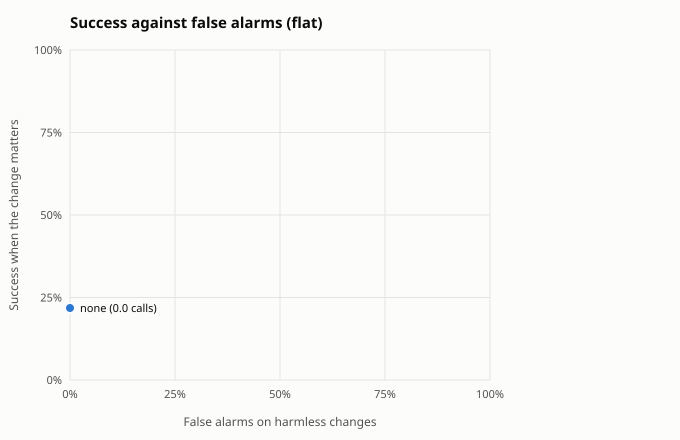
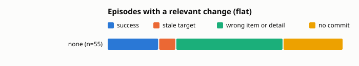

Built from 205 scored episodes.

## Summary by guard

Relevant: the change moved or removed the target the planner saw. Harmless: no change, or one that leaves the target where it was. Fired: the guard re-planned, re-bound or aborted at least once. Calls: planner plus checker calls per episode.

| architecture | guard | relevant n | fired | success | stale | harmless n | success | false alarms | calls |
|---|---|---|---|---|---|---|---|---|---|
| flat | none | 55 | 0% | 22% | 7% | 145 | 22% | 0% | 0.0 |

## By change kind

Success on each kind of change. When the change removed the target there is no correct item, so the column counts episodes that held off: no commit, or a guard abort.

| architecture | guard | no change | irrelevant | relevant | target removed: held off |
|---|---|---|---|---|---|
| flat | none | 34% of 70 | 11% of 75 | 22% of 55 | 40% of 5 |

## Relevant changes by task

Success on episodes whose change moved the target, per task.

| architecture | guard | inbox relative | shop cheapest | shop highest_rated |
|---|---|---|---|---|
| flat | none | 10% of 20 | 20% of 20 | 40% of 15 |

## Outcomes

| architecture | guard | domain | kind | change | n | success | stale | wrong_item | wrong_detail | aborted | no_commit | planner calls |
|---|---|---|---|---|---|---|---|---|---|---|---|---|
| flat | none | inbox | fixed | irrelevant | 30 | 0% | 0% | 67% | 0% | 0% | 33% | 0.0 |
| flat | none | inbox | fixed | none | 20 | 35% | 0% | 25% | 0% | 0% | 40% | 0.0 |
| flat | none | inbox | relative | irrelevant | 10 | 0% | 0% | 50% | 0% | 0% | 50% | 0.0 |
| flat | none | inbox | relative | none | 20 | 25% | 0% | 30% | 0% | 0% | 45% | 0.0 |
| flat | none | inbox | relative | relevant | 20 | 10% | 0% | 45% | 0% | 0% | 45% | 0.0 |
| flat | none | shop | cheapest | irrelevant | 5 | 0% | 0% | 100% | 0% | 0% | 0% | 0.0 |
| flat | none | shop | cheapest | none | 10 | 30% | 0% | 40% | 0% | 0% | 30% | 0.0 |
| flat | none | shop | cheapest | relevant | 20 | 20% | 20% | 55% | 0% | 0% | 5% | 0.0 |
| flat | none | shop | fixed | irrelevant | 20 | 35% | 0% | 45% | 0% | 0% | 20% | 0.0 |
| flat | none | shop | fixed | none | 10 | 60% | 0% | 30% | 0% | 0% | 10% | 0.0 |
| flat | none | shop | fixed | target_removed | 5 | 0% | 0% | 60% | 0% | 0% | 40% | 0.0 |
| flat | none | shop | highest_rated | irrelevant | 10 | 10% | 0% | 80% | 0% | 0% | 10% | 0.0 |
| flat | none | shop | highest_rated | none | 10 | 30% | 0% | 40% | 0% | 0% | 30% | 0.0 |
| flat | none | shop | highest_rated | relevant | 15 | 40% | 0% | 33% | 0% | 0% | 27% | 0.0 |

## Cost per episode

Means per episode. Model seconds add up the latency of every model call, so they include time spent waiting in a shared server's batch; compare them within one run set only.

| architecture | guard | planner calls | checker calls | executor calls | model seconds | actions |
|---|---|---|---|---|---|---|
| flat | none | 0.0 | 0.0 | 8.5 | 190.2 | 5.2 |

## False alarms on harmless changes

| architecture | guard | harmless episodes | false alarm rate | planner calls |
|---|---|---|---|---|
| flat | none | 145 | 0% | 0.0 |

## Paired against `none` on relevant changes

Same scenarios in both arms. Difference is the guard's success rate minus the baseline's, with a 95% bootstrap interval over scenario templates (10000 resamples, seed 0) and an exact McNemar test on the discordant pairs.

| architecture | guard | domain | pairs | none | guard | difference | 95% CI | only guard vs only baseline succeeded | McNemar |
|---|---|---|---|---|---|---|---|---|---|
