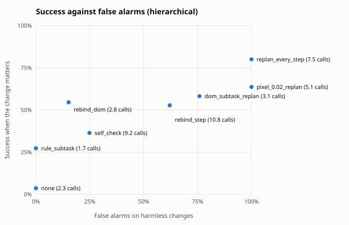
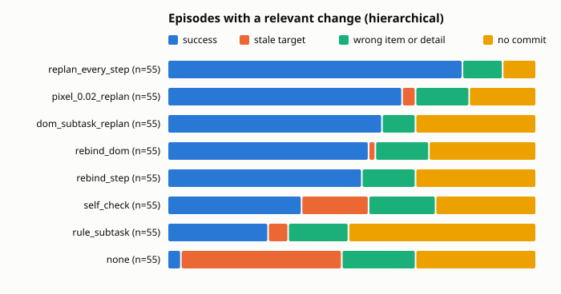

Built from 1640 scored episodes.

## Summary by guard

Relevant: the change moved or removed the target the planner saw. Harmless: no change, or one that leaves the target where it was. Calls: planner plus checker calls per episode.

| architecture | guard | relevant n | success | stale | harmless n | success | false alarms | calls |
|---|---|---|---|---|---|---|---|---|
| hierarchical | replan_every_step | 55 | 80% | 0% | 145 | 77% | 100% | 7.5 |
| hierarchical | rebind_step | 55 | 53% | 0% | 145 | 63% | 62% | 10.8 |
| hierarchical | pixel_0.02_replan | 55 | 64% | 4% | 145 | 69% | 100% | 5.1 |
| hierarchical | rebind_dom | 55 | 55% | 2% | 145 | 68% | 15% | 2.8 |
| hierarchical | self_check | 55 | 36% | 18% | 145 | 68% | 25% | 9.2 |
| hierarchical | rule_subtask | 55 | 27% | 5% | 145 | 50% | 0% | 1.7 |
| hierarchical | none | 55 | 4% | 44% | 145 | 69% | 0% | 2.3 |
| hierarchical | dom_subtask_replan | 55 | 58% | 0% | 145 | 67% | 76% | 3.1 |

## By change kind

Success on each kind of change. When the change removed the target there is no correct item, so the column counts episodes that held off: no commit, or a guard abort.

| architecture | guard | no change | irrelevant | relevant | target removed: held off |
|---|---|---|---|---|---|
| hierarchical | replan_every_step | 69% of 70 | 84% of 75 | 80% of 55 | 80% of 5 |
| hierarchical | rebind_step | 59% of 70 | 67% of 75 | 53% of 55 | 80% of 5 |
| hierarchical | pixel_0.02_replan | 61% of 70 | 76% of 75 | 64% of 55 | 80% of 5 |
| hierarchical | rebind_dom | 59% of 70 | 76% of 75 | 55% of 55 | 80% of 5 |
| hierarchical | self_check | 60% of 70 | 76% of 75 | 36% of 55 | 80% of 5 |
| hierarchical | rule_subtask | 46% of 70 | 55% of 75 | 27% of 55 | 100% of 5 |
| hierarchical | none | 63% of 70 | 75% of 75 | 4% of 55 | 80% of 5 |
| hierarchical | dom_subtask_replan | 59% of 70 | 75% of 75 | 58% of 55 | 100% of 5 |

## Relevant changes by task

Success on episodes whose change moved the target, per task.

| architecture | guard | inbox relative | shop cheapest | shop highest_rated |
|---|---|---|---|---|
| hierarchical | replan_every_step | 75% of 20 | 80% of 20 | 87% of 15 |
| hierarchical | rebind_step | 50% of 20 | 55% of 20 | 53% of 15 |
| hierarchical | pixel_0.02_replan | 50% of 20 | 60% of 20 | 87% of 15 |
| hierarchical | rebind_dom | 50% of 20 | 55% of 20 | 60% of 15 |
| hierarchical | self_check | 30% of 20 | 40% of 20 | 40% of 15 |
| hierarchical | rule_subtask | 20% of 20 | 15% of 20 | 53% of 15 |
| hierarchical | none | 0% of 20 | 10% of 20 | 0% of 15 |
| hierarchical | dom_subtask_replan | 50% of 20 | 60% of 20 | 67% of 15 |

## Outcomes

| architecture | guard | domain | kind | change | n | success | stale | wrong_item | wrong_detail | aborted | no_commit | planner calls |
|---|---|---|---|---|---|---|---|---|---|---|---|---|
| hierarchical | none | inbox | fixed | irrelevant | 30 | 70% | 0% | 0% | 0% | 0% | 30% | 2.0 |
| hierarchical | none | inbox | fixed | none | 20 | 70% | 0% | 0% | 0% | 0% | 30% | 2.0 |
| hierarchical | none | inbox | relative | irrelevant | 10 | 60% | 0% | 0% | 0% | 0% | 40% | 2.2 |
| hierarchical | none | inbox | relative | none | 20 | 60% | 0% | 0% | 0% | 0% | 40% | 2.1 |
| hierarchical | none | inbox | relative | relevant | 20 | 0% | 60% | 0% | 0% | 0% | 40% | 2.2 |
| hierarchical | none | shop | cheapest | irrelevant | 5 | 40% | 0% | 40% | 0% | 0% | 20% | 2.6 |
| hierarchical | none | shop | cheapest | none | 10 | 20% | 0% | 20% | 0% | 0% | 60% | 1.8 |
| hierarchical | none | shop | cheapest | relevant | 20 | 10% | 20% | 40% | 0% | 0% | 30% | 2.2 |
| hierarchical | none | shop | fixed | irrelevant | 20 | 100% | 0% | 0% | 0% | 0% | 0% | 3.0 |
| hierarchical | none | shop | fixed | none | 10 | 90% | 0% | 10% | 0% | 0% | 0% | 3.0 |
| hierarchical | none | shop | fixed | target_removed | 5 | 0% | 0% | 20% | 0% | 0% | 80% | 1.2 |
| hierarchical | none | shop | highest_rated | irrelevant | 10 | 70% | 0% | 20% | 0% | 0% | 10% | 2.8 |
| hierarchical | none | shop | highest_rated | none | 10 | 70% | 0% | 10% | 0% | 0% | 20% | 2.6 |
| hierarchical | none | shop | highest_rated | relevant | 15 | 0% | 53% | 20% | 0% | 0% | 27% | 2.5 |
| hierarchical | dom_subtask_replan | inbox | fixed | irrelevant | 30 | 70% | 0% | 0% | 0% | 0% | 30% | 3.0 |
| hierarchical | dom_subtask_replan | inbox | fixed | none | 20 | 70% | 0% | 0% | 0% | 0% | 30% | 2.5 |
| hierarchical | dom_subtask_replan | inbox | relative | irrelevant | 10 | 60% | 0% | 0% | 0% | 0% | 40% | 3.2 |
| hierarchical | dom_subtask_replan | inbox | relative | none | 20 | 60% | 0% | 0% | 0% | 0% | 40% | 2.6 |
| hierarchical | dom_subtask_replan | inbox | relative | relevant | 20 | 50% | 0% | 0% | 0% | 0% | 50% | 3.0 |
| hierarchical | dom_subtask_replan | shop | cheapest | irrelevant | 5 | 40% | 0% | 40% | 0% | 0% | 20% | 3.6 |
| hierarchical | dom_subtask_replan | shop | cheapest | none | 10 | 30% | 0% | 40% | 0% | 0% | 30% | 2.7 |
| hierarchical | dom_subtask_replan | shop | cheapest | relevant | 20 | 60% | 0% | 15% | 0% | 0% | 25% | 3.4 |
| hierarchical | dom_subtask_replan | shop | fixed | irrelevant | 20 | 100% | 0% | 0% | 0% | 0% | 0% | 4.0 |
| hierarchical | dom_subtask_replan | shop | fixed | none | 10 | 90% | 0% | 10% | 0% | 0% | 0% | 3.5 |
| hierarchical | dom_subtask_replan | shop | fixed | target_removed | 5 | 0% | 0% | 0% | 0% | 0% | 100% | 2.0 |
| hierarchical | dom_subtask_replan | shop | highest_rated | irrelevant | 10 | 70% | 0% | 30% | 0% | 0% | 0% | 3.9 |
| hierarchical | dom_subtask_replan | shop | highest_rated | none | 10 | 30% | 0% | 30% | 0% | 0% | 40% | 2.7 |
| hierarchical | dom_subtask_replan | shop | highest_rated | relevant | 15 | 67% | 0% | 13% | 0% | 0% | 20% | 3.4 |
| hierarchical | pixel_0.02_replan | inbox | fixed | irrelevant | 30 | 70% | 0% | 0% | 0% | 0% | 30% | 6.1 |
| hierarchical | pixel_0.02_replan | inbox | fixed | none | 20 | 70% | 0% | 0% | 0% | 0% | 30% | 4.8 |
| hierarchical | pixel_0.02_replan | inbox | relative | irrelevant | 10 | 50% | 0% | 0% | 0% | 0% | 50% | 8.0 |
| hierarchical | pixel_0.02_replan | inbox | relative | none | 20 | 50% | 0% | 0% | 0% | 0% | 50% | 7.5 |
| hierarchical | pixel_0.02_replan | inbox | relative | relevant | 20 | 50% | 0% | 0% | 0% | 0% | 50% | 8.0 |
| hierarchical | pixel_0.02_replan | shop | cheapest | irrelevant | 5 | 60% | 0% | 40% | 0% | 0% | 0% | 4.0 |
| hierarchical | pixel_0.02_replan | shop | cheapest | none | 10 | 30% | 0% | 70% | 0% | 0% | 0% | 3.5 |
| hierarchical | pixel_0.02_replan | shop | cheapest | relevant | 20 | 60% | 10% | 30% | 0% | 0% | 0% | 3.6 |
| hierarchical | pixel_0.02_replan | shop | fixed | irrelevant | 20 | 100% | 0% | 0% | 0% | 0% | 0% | 3.8 |
| hierarchical | pixel_0.02_replan | shop | fixed | none | 10 | 90% | 0% | 10% | 0% | 0% | 0% | 3.5 |
| hierarchical | pixel_0.02_replan | shop | fixed | target_removed | 5 | 0% | 0% | 20% | 0% | 0% | 80% | 2.6 |
| hierarchical | pixel_0.02_replan | shop | highest_rated | irrelevant | 10 | 80% | 0% | 20% | 0% | 0% | 0% | 3.4 |
| hierarchical | pixel_0.02_replan | shop | highest_rated | none | 10 | 70% | 0% | 30% | 0% | 0% | 0% | 3.5 |
| hierarchical | pixel_0.02_replan | shop | highest_rated | relevant | 15 | 87% | 0% | 13% | 0% | 0% | 0% | 3.8 |
| hierarchical | rebind_dom | inbox | fixed | irrelevant | 30 | 77% | 0% | 7% | 0% | 0% | 17% | 1.9 |
| hierarchical | rebind_dom | inbox | fixed | none | 20 | 85% | 0% | 0% | 0% | 0% | 15% | 1.9 |
| hierarchical | rebind_dom | inbox | relative | irrelevant | 10 | 40% | 0% | 10% | 0% | 0% | 50% | 1.8 |
| hierarchical | rebind_dom | inbox | relative | none | 20 | 45% | 0% | 5% | 0% | 0% | 50% | 1.6 |
| hierarchical | rebind_dom | inbox | relative | relevant | 20 | 50% | 5% | 0% | 0% | 0% | 45% | 1.6 |
| hierarchical | rebind_dom | shop | cheapest | irrelevant | 5 | 40% | 0% | 40% | 0% | 0% | 20% | 2.4 |
| hierarchical | rebind_dom | shop | cheapest | none | 10 | 30% | 0% | 30% | 0% | 0% | 40% | 2.0 |
| hierarchical | rebind_dom | shop | cheapest | relevant | 20 | 55% | 0% | 25% | 0% | 0% | 20% | 2.2 |
| hierarchical | rebind_dom | shop | fixed | irrelevant | 20 | 100% | 0% | 0% | 0% | 0% | 0% | 2.1 |
| hierarchical | rebind_dom | shop | fixed | none | 10 | 80% | 0% | 0% | 0% | 0% | 20% | 2.2 |
| hierarchical | rebind_dom | shop | fixed | target_removed | 5 | 0% | 0% | 20% | 0% | 0% | 80% | 2.4 |
| hierarchical | rebind_dom | shop | highest_rated | irrelevant | 10 | 80% | 0% | 10% | 0% | 0% | 10% | 2.0 |
| hierarchical | rebind_dom | shop | highest_rated | none | 10 | 40% | 0% | 10% | 0% | 0% | 50% | 1.7 |
| hierarchical | rebind_dom | shop | highest_rated | relevant | 15 | 60% | 0% | 20% | 0% | 0% | 20% | 2.1 |
| hierarchical | rebind_step | inbox | fixed | irrelevant | 30 | 53% | 0% | 17% | 0% | 0% | 30% | 1.7 |
| hierarchical | rebind_step | inbox | fixed | none | 20 | 75% | 0% | 0% | 0% | 0% | 25% | 1.6 |
| hierarchical | rebind_step | inbox | relative | irrelevant | 10 | 40% | 0% | 10% | 0% | 0% | 50% | 1.8 |
| hierarchical | rebind_step | inbox | relative | none | 20 | 45% | 0% | 5% | 0% | 0% | 50% | 1.6 |
| hierarchical | rebind_step | inbox | relative | relevant | 20 | 50% | 0% | 0% | 0% | 0% | 50% | 1.8 |
| hierarchical | rebind_step | shop | cheapest | irrelevant | 5 | 40% | 0% | 60% | 0% | 0% | 0% | 3.0 |
| hierarchical | rebind_step | shop | cheapest | none | 10 | 40% | 0% | 20% | 0% | 0% | 40% | 2.2 |
| hierarchical | rebind_step | shop | cheapest | relevant | 20 | 55% | 0% | 25% | 0% | 0% | 20% | 2.3 |
| hierarchical | rebind_step | shop | fixed | irrelevant | 20 | 100% | 0% | 0% | 0% | 0% | 0% | 2.3 |
| hierarchical | rebind_step | shop | fixed | none | 10 | 80% | 0% | 10% | 0% | 0% | 10% | 2.3 |
| hierarchical | rebind_step | shop | fixed | target_removed | 5 | 0% | 0% | 20% | 0% | 0% | 80% | 11.2 |
| hierarchical | rebind_step | shop | highest_rated | irrelevant | 10 | 80% | 0% | 10% | 0% | 0% | 10% | 2.2 |
| hierarchical | rebind_step | shop | highest_rated | none | 10 | 50% | 0% | 10% | 0% | 0% | 40% | 1.8 |
| hierarchical | rebind_step | shop | highest_rated | relevant | 15 | 53% | 0% | 20% | 0% | 0% | 27% | 2.1 |
| hierarchical | replan_every_step | inbox | fixed | irrelevant | 30 | 80% | 0% | 0% | 0% | 0% | 20% | 9.7 |
| hierarchical | replan_every_step | inbox | fixed | none | 20 | 75% | 0% | 0% | 0% | 0% | 25% | 8.2 |
| hierarchical | replan_every_step | inbox | relative | irrelevant | 10 | 80% | 0% | 0% | 0% | 0% | 20% | 13.0 |
| hierarchical | replan_every_step | inbox | relative | none | 20 | 65% | 0% | 0% | 0% | 0% | 35% | 12.5 |
| hierarchical | replan_every_step | inbox | relative | relevant | 20 | 75% | 0% | 0% | 0% | 0% | 25% | 13.0 |
| hierarchical | replan_every_step | shop | cheapest | irrelevant | 5 | 80% | 0% | 20% | 0% | 0% | 0% | 4.0 |
| hierarchical | replan_every_step | shop | cheapest | none | 10 | 40% | 0% | 60% | 0% | 0% | 0% | 3.5 |
| hierarchical | replan_every_step | shop | cheapest | relevant | 20 | 80% | 0% | 20% | 0% | 0% | 0% | 4.0 |
| hierarchical | replan_every_step | shop | fixed | irrelevant | 20 | 100% | 0% | 0% | 0% | 0% | 0% | 4.0 |
| hierarchical | replan_every_step | shop | fixed | none | 10 | 90% | 0% | 10% | 0% | 0% | 0% | 3.5 |
| hierarchical | replan_every_step | shop | fixed | target_removed | 5 | 0% | 0% | 20% | 0% | 0% | 80% | 11.2 |
| hierarchical | replan_every_step | shop | highest_rated | irrelevant | 10 | 70% | 0% | 30% | 0% | 0% | 0% | 4.0 |
| hierarchical | replan_every_step | shop | highest_rated | none | 10 | 70% | 0% | 30% | 0% | 0% | 0% | 3.5 |
| hierarchical | replan_every_step | shop | highest_rated | relevant | 15 | 87% | 0% | 13% | 0% | 0% | 0% | 4.0 |
| hierarchical | rule_subtask | inbox | fixed | irrelevant | 30 | 40% | 0% | 33% | 0% | 0% | 27% | 1.9 |
| hierarchical | rule_subtask | inbox | fixed | none | 20 | 65% | 0% | 0% | 0% | 0% | 35% | 1.8 |
| hierarchical | rule_subtask | inbox | relative | irrelevant | 10 | 20% | 0% | 30% | 0% | 0% | 50% | 1.9 |
| hierarchical | rule_subtask | inbox | relative | none | 20 | 15% | 0% | 35% | 0% | 0% | 50% | 1.7 |
| hierarchical | rule_subtask | inbox | relative | relevant | 20 | 20% | 5% | 30% | 0% | 0% | 45% | 1.7 |
| hierarchical | rule_subtask | shop | cheapest | irrelevant | 5 | 40% | 0% | 20% | 0% | 0% | 40% | 1.4 |
| hierarchical | rule_subtask | shop | cheapest | none | 10 | 20% | 0% | 30% | 0% | 0% | 50% | 1.0 |
| hierarchical | rule_subtask | shop | cheapest | relevant | 20 | 15% | 10% | 10% | 0% | 0% | 65% | 1.1 |
| hierarchical | rule_subtask | shop | fixed | irrelevant | 20 | 95% | 0% | 0% | 0% | 0% | 5% | 2.2 |
| hierarchical | rule_subtask | shop | fixed | none | 10 | 100% | 0% | 0% | 0% | 0% | 0% | 2.7 |
| hierarchical | rule_subtask | shop | fixed | target_removed | 5 | 0% | 0% | 0% | 0% | 0% | 100% | 1.4 |
| hierarchical | rule_subtask | shop | highest_rated | irrelevant | 10 | 60% | 0% | 20% | 0% | 0% | 20% | 1.8 |
| hierarchical | rule_subtask | shop | highest_rated | none | 10 | 40% | 0% | 20% | 0% | 0% | 40% | 1.6 |
| hierarchical | rule_subtask | shop | highest_rated | relevant | 15 | 53% | 0% | 7% | 0% | 0% | 40% | 1.6 |
| hierarchical | self_check | inbox | fixed | irrelevant | 30 | 70% | 0% | 0% | 0% | 0% | 30% | 2.0 |
| hierarchical | self_check | inbox | fixed | none | 20 | 70% | 0% | 0% | 0% | 0% | 30% | 2.0 |
| hierarchical | self_check | inbox | relative | irrelevant | 10 | 60% | 0% | 0% | 0% | 0% | 40% | 2.4 |
| hierarchical | self_check | inbox | relative | none | 20 | 60% | 0% | 0% | 0% | 0% | 40% | 2.4 |
| hierarchical | self_check | inbox | relative | relevant | 20 | 30% | 30% | 0% | 0% | 0% | 40% | 2.8 |
| hierarchical | self_check | shop | cheapest | irrelevant | 5 | 40% | 0% | 40% | 0% | 0% | 20% | 2.6 |
| hierarchical | self_check | shop | cheapest | none | 10 | 30% | 0% | 10% | 0% | 0% | 60% | 2.5 |
| hierarchical | self_check | shop | cheapest | relevant | 20 | 40% | 5% | 35% | 0% | 0% | 20% | 3.0 |
| hierarchical | self_check | shop | fixed | irrelevant | 20 | 100% | 0% | 0% | 0% | 0% | 0% | 3.0 |
| hierarchical | self_check | shop | fixed | none | 10 | 90% | 0% | 10% | 0% | 0% | 0% | 2.9 |
| hierarchical | self_check | shop | fixed | target_removed | 5 | 0% | 0% | 20% | 0% | 0% | 80% | 11.2 |
| hierarchical | self_check | shop | highest_rated | irrelevant | 10 | 80% | 0% | 20% | 0% | 0% | 0% | 3.1 |
| hierarchical | self_check | shop | highest_rated | none | 10 | 40% | 0% | 10% | 0% | 0% | 50% | 2.0 |
| hierarchical | self_check | shop | highest_rated | relevant | 15 | 40% | 20% | 20% | 0% | 0% | 20% | 3.2 |

## False alarms on harmless changes

| architecture | guard | harmless episodes | false alarm rate | planner calls |
|---|---|---|---|---|
| hierarchical | replan_every_step | 145 | 100% | 7.5 |
| hierarchical | rebind_step | 145 | 62% | 2.2 |
| hierarchical | pixel_0.02_replan | 145 | 100% | 5.1 |
| hierarchical | rebind_dom | 145 | 15% | 1.9 |
| hierarchical | self_check | 145 | 25% | 2.8 |
| hierarchical | rule_subtask | 145 | 0% | 1.7 |
| hierarchical | none | 145 | 0% | 2.3 |
| hierarchical | dom_subtask_replan | 145 | 76% | 3.1 |

## Paired against `none` on relevant changes

Same scenarios in both arms. Difference is the guard's success rate minus the baseline's, with a 95% bootstrap interval over scenario templates (10000 resamples, seed 0) and an exact McNemar test on the discordant pairs.

| architecture | guard | domain | pairs | none | guard | difference | 95% CI | only guard vs only baseline succeeded | McNemar |
|---|---|---|---|---|---|---|---|---|---|
| hierarchical | rebind_step | inbox | 20 | 0% | 50% | +50 pts | [+20, +80] | 10 vs 0 | p = 0.002 |
| hierarchical | rebind_step | shop | 35 | 6% | 54% | +49 pts | [+24, +69] | 19 vs 2 | p < 0.001 |
| hierarchical | rebind_step | all | 55 | 4% | 53% | +49 pts | [+30, +67] | 29 vs 2 | p < 0.001 |
| hierarchical | self_check | inbox | 20 | 0% | 30% | +30 pts | [+0, +60] | 6 vs 0 | p = 0.031 |
| hierarchical | self_check | shop | 35 | 6% | 40% | +34 pts | [+14, +54] | 13 vs 1 | p = 0.002 |
| hierarchical | self_check | all | 55 | 4% | 36% | +33 pts | [+16, +49] | 19 vs 1 | p < 0.001 |
| hierarchical | rebind_dom | inbox | 20 | 0% | 50% | +50 pts | [+20, +80] | 10 vs 0 | p = 0.002 |
| hierarchical | rebind_dom | shop | 35 | 6% | 57% | +51 pts | [+29, +70] | 20 vs 2 | p < 0.001 |
| hierarchical | rebind_dom | all | 55 | 4% | 55% | +51 pts | [+33, +68] | 30 vs 2 | p < 0.001 |
| hierarchical | rule_subtask | inbox | 20 | 0% | 20% | +20 pts | [+0, +40] | 4 vs 0 | p = 0.125 |
| hierarchical | rule_subtask | shop | 35 | 6% | 31% | +26 pts | [+0, +52] | 11 vs 2 | p = 0.022 |
| hierarchical | rule_subtask | all | 55 | 4% | 27% | +24 pts | [+6, +42] | 15 vs 2 | p = 0.002 |
| hierarchical | pixel_0.02_replan | inbox | 20 | 0% | 50% | +50 pts | [+20, +80] | 10 vs 0 | p = 0.002 |
| hierarchical | pixel_0.02_replan | shop | 35 | 6% | 71% | +66 pts | [+51, +81] | 23 vs 0 | p < 0.001 |
| hierarchical | pixel_0.02_replan | all | 55 | 4% | 64% | +60 pts | [+45, +75] | 33 vs 0 | p < 0.001 |
| hierarchical | replan_every_step | inbox | 20 | 0% | 75% | +75 pts | [+50, +100] | 15 vs 0 | p < 0.001 |
| hierarchical | replan_every_step | shop | 35 | 6% | 83% | +77 pts | [+59, +92] | 27 vs 0 | p < 0.001 |
| hierarchical | replan_every_step | all | 55 | 4% | 80% | +76 pts | [+62, +90] | 42 vs 0 | p < 0.001 |
| hierarchical | dom_subtask_replan | inbox | 20 | 0% | 50% | +50 pts | [+20, +80] | 10 vs 0 | p = 0.002 |
| hierarchical | dom_subtask_replan | shop | 35 | 6% | 63% | +57 pts | [+36, +76] | 20 vs 0 | p < 0.001 |
| hierarchical | dom_subtask_replan | all | 55 | 4% | 58% | +55 pts | [+37, +71] | 30 vs 0 | p < 0.001 |
