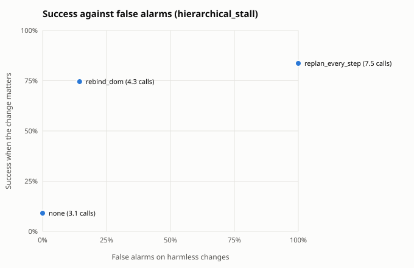
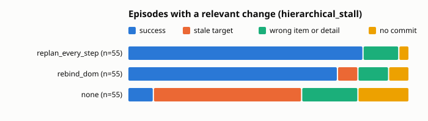

Built from 615 scored episodes.

## Summary by guard

Relevant: the change moved or removed the target the planner saw. Harmless: no change, or one that leaves the target where it was. Fired: the guard re-planned, re-bound or aborted at least once. Calls: planner plus checker calls per episode.

| architecture | guard | relevant n | fired | success | stale | harmless n | success | false alarms | calls |
|---|---|---|---|---|---|---|---|---|---|
| hierarchical_stall | rebind_dom | 55 | 93% | 75% | 7% | 145 | 76% | 14% | 4.3 |
| hierarchical_stall | replan_every_step | 55 | 100% | 84% | 0% | 145 | 81% | 100% | 7.5 |
| hierarchical_stall | none | 55 | 0% | 9% | 53% | 145 | 78% | 0% | 3.1 |

## By change kind

Success on each kind of change. When the change removed the target there is no correct item, so the column counts episodes that held off: no commit, or a guard abort.

| architecture | guard | no change | irrelevant | relevant | target removed: held off |
|---|---|---|---|---|---|
| hierarchical_stall | rebind_dom | 73% of 70 | 79% of 75 | 75% of 55 | 80% of 5 |
| hierarchical_stall | replan_every_step | 79% of 70 | 84% of 75 | 84% of 55 | 80% of 5 |
| hierarchical_stall | none | 74% of 70 | 81% of 75 | 9% of 55 | 60% of 5 |

## Relevant changes by task

Success on episodes whose change moved the target, per task.

| architecture | guard | inbox relative | shop cheapest | shop highest_rated |
|---|---|---|---|---|
| hierarchical_stall | rebind_dom | 65% of 20 | 80% of 20 | 80% of 15 |
| hierarchical_stall | replan_every_step | 90% of 20 | 75% of 20 | 87% of 15 |
| hierarchical_stall | none | 0% of 20 | 15% of 20 | 13% of 15 |

## Outcomes

| architecture | guard | domain | kind | change | n | success | stale | wrong_item | wrong_detail | aborted | no_commit | planner calls |
|---|---|---|---|---|---|---|---|---|---|---|---|---|
| hierarchical_stall | none | inbox | fixed | irrelevant | 30 | 80% | 0% | 0% | 0% | 0% | 20% | 3.3 |
| hierarchical_stall | none | inbox | fixed | none | 20 | 75% | 0% | 0% | 0% | 0% | 25% | 3.4 |
| hierarchical_stall | none | inbox | relative | irrelevant | 10 | 90% | 0% | 0% | 0% | 0% | 10% | 3.4 |
| hierarchical_stall | none | inbox | relative | none | 20 | 90% | 0% | 0% | 0% | 0% | 10% | 3.4 |
| hierarchical_stall | none | inbox | relative | relevant | 20 | 0% | 90% | 0% | 0% | 0% | 10% | 3.3 |
| hierarchical_stall | none | shop | cheapest | irrelevant | 5 | 20% | 0% | 40% | 0% | 0% | 40% | 2.2 |
| hierarchical_stall | none | shop | cheapest | none | 10 | 20% | 0% | 40% | 0% | 0% | 40% | 2.2 |
| hierarchical_stall | none | shop | cheapest | relevant | 20 | 15% | 15% | 35% | 0% | 0% | 35% | 2.4 |
| hierarchical_stall | none | shop | fixed | irrelevant | 20 | 100% | 0% | 0% | 0% | 0% | 0% | 3.0 |
| hierarchical_stall | none | shop | fixed | none | 10 | 90% | 0% | 10% | 0% | 0% | 0% | 3.0 |
| hierarchical_stall | none | shop | fixed | target_removed | 5 | 0% | 0% | 40% | 0% | 0% | 60% | 5.6 |
| hierarchical_stall | none | shop | highest_rated | irrelevant | 10 | 70% | 0% | 20% | 0% | 0% | 10% | 2.8 |
| hierarchical_stall | none | shop | highest_rated | none | 10 | 80% | 0% | 20% | 0% | 0% | 0% | 3.0 |
| hierarchical_stall | none | shop | highest_rated | relevant | 15 | 13% | 53% | 27% | 0% | 0% | 7% | 3.1 |
| hierarchical_stall | rebind_dom | inbox | fixed | irrelevant | 30 | 70% | 0% | 10% | 0% | 0% | 20% | 4.3 |
| hierarchical_stall | rebind_dom | inbox | fixed | none | 20 | 75% | 0% | 0% | 0% | 0% | 25% | 3.9 |
| hierarchical_stall | rebind_dom | inbox | relative | irrelevant | 10 | 70% | 0% | 10% | 0% | 0% | 20% | 4.3 |
| hierarchical_stall | rebind_dom | inbox | relative | none | 20 | 65% | 0% | 5% | 0% | 0% | 30% | 4.7 |
| hierarchical_stall | rebind_dom | inbox | relative | relevant | 20 | 65% | 20% | 0% | 0% | 0% | 15% | 3.3 |
| hierarchical_stall | rebind_dom | shop | cheapest | irrelevant | 5 | 40% | 0% | 60% | 0% | 0% | 0% | 2.8 |
| hierarchical_stall | rebind_dom | shop | cheapest | none | 10 | 50% | 0% | 50% | 0% | 0% | 0% | 2.9 |
| hierarchical_stall | rebind_dom | shop | cheapest | relevant | 20 | 80% | 0% | 20% | 0% | 0% | 0% | 2.8 |
| hierarchical_stall | rebind_dom | shop | fixed | irrelevant | 20 | 100% | 0% | 0% | 0% | 0% | 0% | 2.9 |
| hierarchical_stall | rebind_dom | shop | fixed | none | 10 | 90% | 0% | 10% | 0% | 0% | 0% | 3.2 |
| hierarchical_stall | rebind_dom | shop | fixed | target_removed | 5 | 0% | 0% | 20% | 0% | 0% | 80% | 3.4 |
| hierarchical_stall | rebind_dom | shop | highest_rated | irrelevant | 10 | 90% | 0% | 10% | 0% | 0% | 0% | 2.8 |
| hierarchical_stall | rebind_dom | shop | highest_rated | none | 10 | 90% | 0% | 10% | 0% | 0% | 0% | 2.8 |
| hierarchical_stall | rebind_dom | shop | highest_rated | relevant | 15 | 80% | 0% | 13% | 0% | 0% | 7% | 2.8 |
| hierarchical_stall | replan_every_step | inbox | fixed | irrelevant | 30 | 80% | 0% | 0% | 0% | 0% | 20% | 10.1 |
| hierarchical_stall | replan_every_step | inbox | fixed | none | 20 | 80% | 0% | 0% | 0% | 0% | 20% | 8.3 |
| hierarchical_stall | replan_every_step | inbox | relative | irrelevant | 10 | 90% | 0% | 0% | 0% | 0% | 10% | 12.7 |
| hierarchical_stall | replan_every_step | inbox | relative | none | 20 | 90% | 0% | 0% | 0% | 0% | 10% | 12.5 |
| hierarchical_stall | replan_every_step | inbox | relative | relevant | 20 | 90% | 0% | 0% | 0% | 0% | 10% | 12.9 |
| hierarchical_stall | replan_every_step | shop | cheapest | irrelevant | 5 | 60% | 0% | 40% | 0% | 0% | 0% | 4.0 |
| hierarchical_stall | replan_every_step | shop | cheapest | none | 10 | 50% | 0% | 50% | 0% | 0% | 0% | 3.5 |
| hierarchical_stall | replan_every_step | shop | cheapest | relevant | 20 | 75% | 0% | 25% | 0% | 0% | 0% | 4.0 |
| hierarchical_stall | replan_every_step | shop | fixed | irrelevant | 20 | 100% | 0% | 0% | 0% | 0% | 0% | 4.0 |
| hierarchical_stall | replan_every_step | shop | fixed | none | 10 | 90% | 0% | 10% | 0% | 0% | 0% | 3.5 |
| hierarchical_stall | replan_every_step | shop | fixed | target_removed | 5 | 0% | 0% | 20% | 0% | 0% | 80% | 11.4 |
| hierarchical_stall | replan_every_step | shop | highest_rated | irrelevant | 10 | 70% | 0% | 30% | 0% | 0% | 0% | 4.0 |
| hierarchical_stall | replan_every_step | shop | highest_rated | none | 10 | 70% | 0% | 30% | 0% | 0% | 0% | 3.5 |
| hierarchical_stall | replan_every_step | shop | highest_rated | relevant | 15 | 87% | 0% | 13% | 0% | 0% | 0% | 4.0 |

## Cost per episode

Means per episode. Model seconds add up the latency of every model call, so they include time spent waiting in a shared server's batch; compare them within one run set only.

| architecture | guard | planner calls | checker calls | executor calls | model seconds | actions |
|---|---|---|---|---|---|---|
| hierarchical_stall | rebind_dom | 3.5 | 0.8 | 7.1 | 129.9 | 6.2 |
| hierarchical_stall | replan_every_step | 7.5 | 0.0 | 6.1 | 198.9 | 6.1 |
| hierarchical_stall | none | 3.1 | 0.0 | 6.4 | 99.6 | 5.2 |

## False alarms on harmless changes

| architecture | guard | harmless episodes | false alarm rate | planner calls |
|---|---|---|---|---|
| hierarchical_stall | rebind_dom | 145 | 14% | 3.5 |
| hierarchical_stall | replan_every_step | 145 | 100% | 7.5 |
| hierarchical_stall | none | 145 | 0% | 3.1 |

## Paired against `none` on relevant changes

Same scenarios in both arms. Difference is the guard's success rate minus the baseline's, with a 95% bootstrap interval over scenario templates (10000 resamples, seed 0) and an exact McNemar test on the discordant pairs.

| architecture | guard | domain | pairs | none | guard | difference | 95% CI | only guard vs only baseline succeeded | McNemar |
|---|---|---|---|---|---|---|---|---|---|
| hierarchical_stall | replan_every_step | inbox | 20 | 0% | 90% | +90 pts | [+70, +100] | 18 vs 0 | p < 0.001 |
| hierarchical_stall | replan_every_step | shop | 35 | 14% | 80% | +66 pts | [+51, +80] | 23 vs 0 | p < 0.001 |
| hierarchical_stall | replan_every_step | all | 55 | 9% | 84% | +75 pts | [+62, +87] | 41 vs 0 | p < 0.001 |
| hierarchical_stall | rebind_dom | inbox | 20 | 0% | 65% | +65 pts | [+35, +90] | 13 vs 0 | p < 0.001 |
| hierarchical_stall | rebind_dom | shop | 35 | 14% | 80% | +66 pts | [+49, +83] | 25 vs 2 | p < 0.001 |
| hierarchical_stall | rebind_dom | all | 55 | 9% | 75% | +65 pts | [+51, +80] | 38 vs 2 | p < 0.001 |
