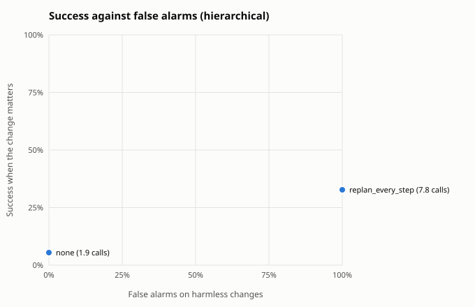
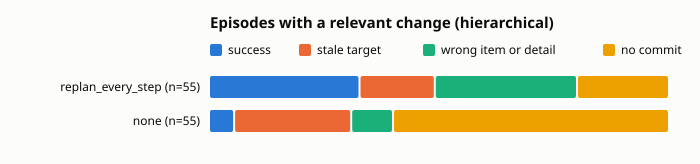

Built from 410 scored episodes.

## Summary by guard

Relevant: the change moved or removed the target the planner saw. Harmless: no change, or one that leaves the target where it was. Calls: planner plus checker calls per episode.

| architecture | guard | relevant n | success | stale | harmless n | success | false alarms | calls |
|---|---|---|---|---|---|---|---|---|
| hierarchical | replan_every_step | 55 | 33% | 16% | 145 | 64% | 100% | 7.8 |
| hierarchical | none | 55 | 5% | 25% | 145 | 59% | 0% | 1.9 |

## By change kind

Success on each kind of change. When the change removed the target there is no correct item, so the column counts episodes that held off: no commit, or a guard abort.

| architecture | guard | no change | irrelevant | relevant | target removed: held off |
|---|---|---|---|---|---|
| hierarchical | replan_every_step | 60% of 70 | 68% of 75 | 33% of 55 | 80% of 5 |
| hierarchical | none | 53% of 70 | 64% of 75 | 5% of 55 | 80% of 5 |

## Relevant changes by task

Success on episodes whose change moved the target, per task.

| architecture | guard | inbox relative | shop cheapest | shop highest_rated |
|---|---|---|---|---|
| hierarchical | replan_every_step | 50% of 20 | 20% of 20 | 27% of 15 |
| hierarchical | none | 0% of 20 | 15% of 20 | 0% of 15 |

## Outcomes

| architecture | guard | domain | kind | change | n | success | stale | wrong_item | wrong_detail | aborted | no_commit | planner calls |
|---|---|---|---|---|---|---|---|---|---|---|---|---|
| hierarchical | none | inbox | fixed | irrelevant | 30 | 70% | 0% | 0% | 0% | 0% | 30% | 2.0 |
| hierarchical | none | inbox | fixed | none | 20 | 70% | 0% | 0% | 0% | 0% | 30% | 2.0 |
| hierarchical | none | inbox | relative | irrelevant | 10 | 60% | 0% | 0% | 0% | 0% | 40% | 2.2 |
| hierarchical | none | inbox | relative | none | 20 | 55% | 0% | 0% | 0% | 0% | 45% | 2.1 |
| hierarchical | none | inbox | relative | relevant | 20 | 0% | 60% | 0% | 0% | 0% | 40% | 2.2 |
| hierarchical | none | shop | cheapest | irrelevant | 5 | 20% | 0% | 0% | 0% | 0% | 80% | 1.4 |
| hierarchical | none | shop | cheapest | none | 10 | 20% | 0% | 10% | 0% | 0% | 70% | 1.4 |
| hierarchical | none | shop | cheapest | relevant | 20 | 15% | 10% | 20% | 0% | 0% | 55% | 1.8 |
| hierarchical | none | shop | fixed | irrelevant | 20 | 100% | 0% | 0% | 0% | 0% | 0% | 3.0 |
| hierarchical | none | shop | fixed | none | 10 | 100% | 0% | 0% | 0% | 0% | 0% | 3.0 |
| hierarchical | none | shop | fixed | target_removed | 5 | 0% | 0% | 20% | 0% | 0% | 80% | 1.2 |
| hierarchical | none | shop | highest_rated | irrelevant | 10 | 0% | 0% | 0% | 0% | 0% | 100% | 1.0 |
| hierarchical | none | shop | highest_rated | none | 10 | 0% | 0% | 10% | 0% | 0% | 90% | 1.2 |
| hierarchical | none | shop | highest_rated | relevant | 15 | 0% | 0% | 7% | 0% | 0% | 93% | 1.1 |
| hierarchical | replan_every_step | inbox | fixed | irrelevant | 30 | 73% | 0% | 0% | 0% | 0% | 27% | 8.0 |
| hierarchical | replan_every_step | inbox | fixed | none | 20 | 80% | 0% | 0% | 0% | 0% | 20% | 7.7 |
| hierarchical | replan_every_step | inbox | relative | irrelevant | 10 | 80% | 0% | 0% | 0% | 0% | 20% | 12.0 |
| hierarchical | replan_every_step | inbox | relative | none | 20 | 65% | 0% | 0% | 0% | 0% | 35% | 12.0 |
| hierarchical | replan_every_step | inbox | relative | relevant | 20 | 50% | 30% | 0% | 0% | 0% | 20% | 12.0 |
| hierarchical | replan_every_step | shop | cheapest | irrelevant | 5 | 20% | 0% | 80% | 0% | 0% | 0% | 3.6 |
| hierarchical | replan_every_step | shop | cheapest | none | 10 | 20% | 0% | 70% | 0% | 0% | 10% | 3.9 |
| hierarchical | replan_every_step | shop | cheapest | relevant | 20 | 20% | 15% | 65% | 0% | 0% | 0% | 3.5 |
| hierarchical | replan_every_step | shop | fixed | irrelevant | 20 | 100% | 0% | 0% | 0% | 0% | 0% | 3.0 |
| hierarchical | replan_every_step | shop | fixed | none | 10 | 100% | 0% | 0% | 0% | 0% | 0% | 3.0 |
| hierarchical | replan_every_step | shop | fixed | target_removed | 5 | 0% | 0% | 20% | 0% | 0% | 80% | 10.6 |
| hierarchical | replan_every_step | shop | highest_rated | irrelevant | 10 | 0% | 0% | 40% | 0% | 0% | 60% | 10.2 |
| hierarchical | replan_every_step | shop | highest_rated | none | 10 | 10% | 0% | 10% | 0% | 0% | 80% | 10.7 |
| hierarchical | replan_every_step | shop | highest_rated | relevant | 15 | 27% | 0% | 27% | 0% | 0% | 47% | 9.1 |

## Cost per episode

Means per episode. Model seconds add up the latency of every model call, so they include time spent waiting in a shared server's batch; compare them within one run set only.

| architecture | guard | planner calls | checker calls | executor calls | model seconds | actions |
|---|---|---|---|---|---|---|
| hierarchical | replan_every_step | 7.8 | 0.0 | 7.4 | 94.2 | 7.3 |
| hierarchical | none | 1.9 | 0.0 | 8.5 | 86.1 | 7.5 |

## False alarms on harmless changes

| architecture | guard | harmless episodes | false alarm rate | planner calls |
|---|---|---|---|---|
| hierarchical | replan_every_step | 145 | 100% | 7.8 |
| hierarchical | none | 145 | 0% | 1.9 |

## Paired against `none` on relevant changes

Same scenarios in both arms. Difference is the guard's success rate minus the baseline's, with a 95% bootstrap interval over scenario templates (10000 resamples, seed 0) and an exact McNemar test on the discordant pairs.

| architecture | guard | domain | pairs | none | guard | difference | 95% CI | only guard vs only baseline succeeded | McNemar |
|---|---|---|---|---|---|---|---|---|---|
| hierarchical | replan_every_step | shop | 35 | 9% | 23% | +14 pts | [-3, +32] | 6 vs 1 | p = 0.125 |
| hierarchical | replan_every_step | inbox | 20 | 0% | 50% | +50 pts | [+20, +80] | 10 vs 0 | p = 0.002 |
| hierarchical | replan_every_step | all | 55 | 5% | 33% | +27 pts | [+11, +46] | 16 vs 1 | p < 0.001 |
