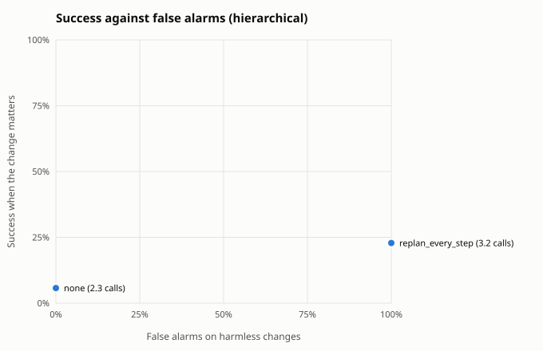
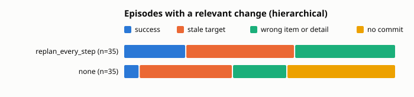

Built from 140 scored episodes.

## Summary by guard

Relevant: the change moved or removed the target the planner saw. Harmless: no change, or one that leaves the target where it was. Calls: planner plus checker calls per episode.

| architecture | guard | relevant n | success | stale | harmless n | success | false alarms | calls |
|---|---|---|---|---|---|---|---|---|
| hierarchical | replan_every_step | 35 | 23% | 40% | 35 | 60% | 100% | 3.2 |
| hierarchical | none | 35 | 6% | 34% | 35 | 46% | 0% | 2.3 |

## By change kind

Success on each kind of change. When the change removed the target there is no correct item, so the column counts episodes that held off: no commit, or a guard abort.

| architecture | guard | no change | irrelevant | relevant | target removed: held off |
|---|---|---|---|---|---|
| hierarchical | replan_every_step | 60% of 20 | 60% of 15 | 23% of 35 | n/a |
| hierarchical | none | 35% of 20 | 60% of 15 | 6% of 35 | n/a |

## Relevant changes by task

Success on episodes whose change moved the target, per task.

| architecture | guard | shop cheapest | shop highest_rated |
|---|---|---|---|
| hierarchical | replan_every_step | 25% of 20 | 20% of 15 |
| hierarchical | none | 10% of 20 | 0% of 15 |

## Outcomes

| architecture | guard | domain | kind | change | n | success | stale | wrong_item | wrong_detail | aborted | no_commit | planner calls |
|---|---|---|---|---|---|---|---|---|---|---|---|---|
| hierarchical | none | shop | cheapest | irrelevant | 5 | 40% | 0% | 40% | 0% | 0% | 20% | 2.4 |
| hierarchical | none | shop | cheapest | none | 10 | 20% | 0% | 40% | 0% | 0% | 40% | 2.0 |
| hierarchical | none | shop | cheapest | relevant | 20 | 10% | 20% | 20% | 0% | 0% | 50% | 2.0 |
| hierarchical | none | shop | highest_rated | irrelevant | 10 | 70% | 0% | 20% | 0% | 0% | 10% | 2.8 |
| hierarchical | none | shop | highest_rated | none | 10 | 50% | 0% | 10% | 0% | 0% | 40% | 2.2 |
| hierarchical | none | shop | highest_rated | relevant | 15 | 0% | 53% | 20% | 0% | 0% | 27% | 2.5 |
| hierarchical | replan_every_step | shop | cheapest | irrelevant | 5 | 40% | 0% | 60% | 0% | 0% | 0% | 3.0 |
| hierarchical | replan_every_step | shop | cheapest | none | 10 | 40% | 0% | 60% | 0% | 0% | 0% | 3.0 |
| hierarchical | replan_every_step | shop | cheapest | relevant | 20 | 25% | 30% | 45% | 0% | 0% | 0% | 3.2 |
| hierarchical | replan_every_step | shop | highest_rated | irrelevant | 10 | 70% | 0% | 30% | 0% | 0% | 0% | 3.0 |
| hierarchical | replan_every_step | shop | highest_rated | none | 10 | 80% | 0% | 20% | 0% | 0% | 0% | 3.0 |
| hierarchical | replan_every_step | shop | highest_rated | relevant | 15 | 20% | 53% | 27% | 0% | 0% | 0% | 3.5 |

## Cost per episode

Means per episode. Model seconds add up the latency of every model call, so they include time spent waiting in a shared server's batch; compare them within one run set only.

| architecture | guard | planner calls | checker calls | executor calls | model seconds | actions |
|---|---|---|---|---|---|---|
| hierarchical | replan_every_step | 3.2 | 0.0 | 2.2 | 32.3 | 2.2 |
| hierarchical | none | 2.3 | 0.0 | 8.0 | 68.5 | 6.7 |

## False alarms on harmless changes

| architecture | guard | harmless episodes | false alarm rate | planner calls |
|---|---|---|---|---|
| hierarchical | replan_every_step | 35 | 100% | 3.2 |
| hierarchical | none | 35 | 0% | 2.3 |

## Paired against `none` on relevant changes

Same scenarios in both arms. Difference is the guard's success rate minus the baseline's, with a 95% bootstrap interval over scenario templates (10000 resamples, seed 0) and an exact McNemar test on the discordant pairs.

| architecture | guard | domain | pairs | none | guard | difference | 95% CI | only guard vs only baseline succeeded | McNemar |
|---|---|---|---|---|---|---|---|---|---|
| hierarchical | replan_every_step | shop | 35 | 6% | 23% | +17 pts | [+8, +26] | 6 vs 0 | p = 0.031 |
| hierarchical | replan_every_step | all | 35 | 6% | 23% | +17 pts | [+8, +26] | 6 vs 0 | p = 0.031 |
