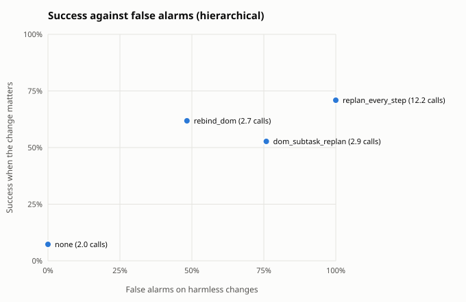
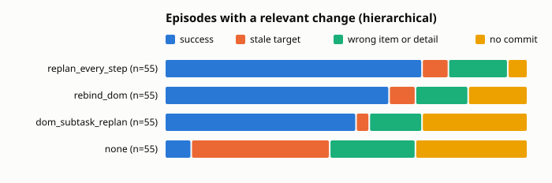

Built from 820 scored episodes.

## Summary by guard

Relevant: the change moved or removed the target the planner saw. Harmless: no change, or one that leaves the target where it was. Fired: the guard re-planned, re-bound or aborted at least once. Calls: planner plus checker calls per episode.

| architecture | guard | relevant n | fired | success | stale | harmless n | success | false alarms | calls |
|---|---|---|---|---|---|---|---|---|---|
| hierarchical | rebind_dom | 55 | 85% | 62% | 7% | 145 | 47% | 48% | 2.7 |
| hierarchical | none | 55 | 0% | 7% | 38% | 145 | 54% | 0% | 2.0 |
| hierarchical | replan_every_step | 55 | 100% | 71% | 7% | 145 | 70% | 100% | 12.2 |
| hierarchical | dom_subtask_replan | 55 | 100% | 53% | 4% | 145 | 54% | 76% | 2.9 |

## By change kind

Success on each kind of change. When the change removed the target there is no correct item, so the column counts episodes that held off: no commit, or a guard abort.

| architecture | guard | no change | irrelevant | relevant | target removed: held off |
|---|---|---|---|---|---|
| hierarchical | rebind_dom | 46% of 70 | 48% of 75 | 62% of 55 | 20% of 5 |
| hierarchical | none | 50% of 70 | 59% of 75 | 7% of 55 | 100% of 5 |
| hierarchical | replan_every_step | 64% of 70 | 76% of 75 | 71% of 55 | 80% of 5 |
| hierarchical | dom_subtask_replan | 47% of 70 | 61% of 75 | 53% of 55 | 80% of 5 |

## Relevant changes by task

Success on episodes whose change moved the target, per task.

| architecture | guard | inbox relative | shop cheapest | shop highest_rated |
|---|---|---|---|---|
| hierarchical | rebind_dom | 55% of 20 | 70% of 20 | 60% of 15 |
| hierarchical | none | 0% of 20 | 15% of 20 | 7% of 15 |
| hierarchical | replan_every_step | 80% of 20 | 70% of 20 | 60% of 15 |
| hierarchical | dom_subtask_replan | 50% of 20 | 65% of 20 | 40% of 15 |

## Outcomes

| architecture | guard | domain | kind | change | n | success | stale | wrong_item | wrong_detail | aborted | no_commit | planner calls |
|---|---|---|---|---|---|---|---|---|---|---|---|---|
| hierarchical | none | inbox | fixed | irrelevant | 30 | 70% | 0% | 0% | 0% | 0% | 30% | 2.1 |
| hierarchical | none | inbox | fixed | none | 20 | 70% | 0% | 0% | 0% | 0% | 30% | 2.0 |
| hierarchical | none | inbox | relative | irrelevant | 10 | 50% | 0% | 0% | 0% | 0% | 50% | 1.9 |
| hierarchical | none | inbox | relative | none | 20 | 50% | 0% | 0% | 0% | 0% | 50% | 2.0 |
| hierarchical | none | inbox | relative | relevant | 20 | 0% | 50% | 0% | 0% | 0% | 50% | 1.9 |
| hierarchical | none | shop | cheapest | irrelevant | 5 | 20% | 0% | 60% | 0% | 0% | 20% | 1.6 |
| hierarchical | none | shop | cheapest | none | 10 | 20% | 0% | 70% | 0% | 0% | 10% | 1.9 |
| hierarchical | none | shop | cheapest | relevant | 20 | 15% | 20% | 50% | 0% | 0% | 15% | 1.9 |
| hierarchical | none | shop | fixed | irrelevant | 20 | 50% | 0% | 0% | 0% | 0% | 50% | 1.9 |
| hierarchical | none | shop | fixed | none | 10 | 30% | 0% | 0% | 0% | 0% | 70% | 1.6 |
| hierarchical | none | shop | fixed | target_removed | 5 | 0% | 0% | 0% | 0% | 0% | 100% | 1.0 |
| hierarchical | none | shop | highest_rated | irrelevant | 10 | 70% | 0% | 30% | 0% | 0% | 0% | 2.9 |
| hierarchical | none | shop | highest_rated | none | 10 | 60% | 0% | 0% | 0% | 0% | 40% | 2.2 |
| hierarchical | none | shop | highest_rated | relevant | 15 | 7% | 47% | 20% | 0% | 0% | 27% | 2.5 |
| hierarchical | dom_subtask_replan | inbox | fixed | irrelevant | 30 | 70% | 0% | 0% | 0% | 0% | 30% | 3.1 |
| hierarchical | dom_subtask_replan | inbox | fixed | none | 20 | 70% | 0% | 0% | 0% | 0% | 30% | 2.5 |
| hierarchical | dom_subtask_replan | inbox | relative | irrelevant | 10 | 50% | 0% | 0% | 0% | 0% | 50% | 3.0 |
| hierarchical | dom_subtask_replan | inbox | relative | none | 20 | 50% | 0% | 0% | 0% | 0% | 50% | 2.5 |
| hierarchical | dom_subtask_replan | inbox | relative | relevant | 20 | 50% | 0% | 0% | 0% | 0% | 50% | 3.0 |
| hierarchical | dom_subtask_replan | shop | cheapest | irrelevant | 5 | 20% | 0% | 60% | 0% | 0% | 20% | 2.8 |
| hierarchical | dom_subtask_replan | shop | cheapest | none | 10 | 40% | 0% | 60% | 0% | 0% | 0% | 2.7 |
| hierarchical | dom_subtask_replan | shop | cheapest | relevant | 20 | 65% | 5% | 25% | 0% | 0% | 5% | 3.1 |
| hierarchical | dom_subtask_replan | shop | fixed | irrelevant | 20 | 60% | 0% | 0% | 0% | 0% | 40% | 3.1 |
| hierarchical | dom_subtask_replan | shop | fixed | none | 10 | 20% | 0% | 0% | 0% | 0% | 80% | 1.9 |
| hierarchical | dom_subtask_replan | shop | fixed | target_removed | 5 | 0% | 0% | 20% | 0% | 0% | 80% | 2.4 |
| hierarchical | dom_subtask_replan | shop | highest_rated | irrelevant | 10 | 70% | 0% | 30% | 0% | 0% | 0% | 4.0 |
| hierarchical | dom_subtask_replan | shop | highest_rated | none | 10 | 30% | 0% | 20% | 0% | 0% | 50% | 2.5 |
| hierarchical | dom_subtask_replan | shop | highest_rated | relevant | 15 | 40% | 7% | 20% | 0% | 0% | 33% | 3.3 |
| hierarchical | rebind_dom | inbox | fixed | irrelevant | 30 | 20% | 0% | 60% | 0% | 0% | 20% | 1.8 |
| hierarchical | rebind_dom | inbox | fixed | none | 20 | 50% | 0% | 35% | 0% | 0% | 15% | 2.0 |
| hierarchical | rebind_dom | inbox | relative | irrelevant | 10 | 0% | 0% | 60% | 0% | 0% | 40% | 1.4 |
| hierarchical | rebind_dom | inbox | relative | none | 20 | 25% | 0% | 35% | 0% | 0% | 40% | 1.6 |
| hierarchical | rebind_dom | inbox | relative | relevant | 20 | 55% | 5% | 0% | 0% | 0% | 40% | 1.9 |
| hierarchical | rebind_dom | shop | cheapest | irrelevant | 5 | 20% | 0% | 80% | 0% | 0% | 0% | 2.0 |
| hierarchical | rebind_dom | shop | cheapest | none | 10 | 20% | 0% | 70% | 0% | 0% | 10% | 1.9 |
| hierarchical | rebind_dom | shop | cheapest | relevant | 20 | 70% | 5% | 25% | 0% | 0% | 0% | 2.0 |
| hierarchical | rebind_dom | shop | fixed | irrelevant | 20 | 100% | 0% | 0% | 0% | 0% | 0% | 2.0 |
| hierarchical | rebind_dom | shop | fixed | none | 10 | 90% | 0% | 0% | 0% | 0% | 10% | 1.9 |
| hierarchical | rebind_dom | shop | fixed | target_removed | 5 | 0% | 0% | 80% | 0% | 0% | 20% | 2.8 |
| hierarchical | rebind_dom | shop | highest_rated | irrelevant | 10 | 90% | 0% | 10% | 0% | 0% | 0% | 2.0 |
| hierarchical | rebind_dom | shop | highest_rated | none | 10 | 60% | 0% | 20% | 0% | 0% | 20% | 1.8 |
| hierarchical | rebind_dom | shop | highest_rated | relevant | 15 | 60% | 13% | 20% | 0% | 0% | 7% | 2.1 |
| hierarchical | replan_every_step | inbox | fixed | irrelevant | 30 | 70% | 0% | 0% | 0% | 0% | 30% | 13.7 |
| hierarchical | replan_every_step | inbox | fixed | none | 20 | 70% | 0% | 0% | 0% | 0% | 30% | 12.3 |
| hierarchical | replan_every_step | inbox | relative | irrelevant | 10 | 90% | 0% | 0% | 0% | 0% | 10% | 12.1 |
| hierarchical | replan_every_step | inbox | relative | none | 20 | 65% | 0% | 0% | 0% | 0% | 35% | 10.9 |
| hierarchical | replan_every_step | inbox | relative | relevant | 20 | 80% | 5% | 0% | 0% | 0% | 15% | 10.9 |
| hierarchical | replan_every_step | shop | cheapest | irrelevant | 5 | 20% | 0% | 80% | 0% | 0% | 0% | 13.0 |
| hierarchical | replan_every_step | shop | cheapest | none | 10 | 30% | 0% | 70% | 0% | 0% | 0% | 12.5 |
| hierarchical | replan_every_step | shop | cheapest | relevant | 20 | 70% | 5% | 25% | 0% | 0% | 0% | 13.0 |
| hierarchical | replan_every_step | shop | fixed | irrelevant | 20 | 100% | 0% | 0% | 0% | 0% | 0% | 12.1 |
| hierarchical | replan_every_step | shop | fixed | none | 10 | 90% | 0% | 10% | 0% | 0% | 0% | 8.3 |
| hierarchical | replan_every_step | shop | fixed | target_removed | 5 | 0% | 0% | 20% | 0% | 0% | 80% | 13.0 |
| hierarchical | replan_every_step | shop | highest_rated | irrelevant | 10 | 60% | 0% | 40% | 0% | 0% | 0% | 13.1 |
| hierarchical | replan_every_step | shop | highest_rated | none | 10 | 60% | 0% | 40% | 0% | 0% | 0% | 11.3 |
| hierarchical | replan_every_step | shop | highest_rated | relevant | 15 | 60% | 13% | 27% | 0% | 0% | 0% | 12.7 |

## Cost per episode

Means per episode. Model seconds add up the latency of every model call, so they include time spent waiting in a shared server's batch; compare them within one run set only.

| architecture | guard | planner calls | checker calls | executor calls | model seconds | actions |
|---|---|---|---|---|---|---|
| hierarchical | rebind_dom | 1.9 | 0.8 | 8.7 | 137.7 | 7.9 |
| hierarchical | none | 2.0 | 0.0 | 9.3 | 148.7 | 8.3 |
| hierarchical | replan_every_step | 12.2 | 0.0 | 11.2 | 185.5 | 10.8 |
| hierarchical | dom_subtask_replan | 2.9 | 0.0 | 9.6 | 151.1 | 8.5 |

## False alarms on harmless changes

| architecture | guard | harmless episodes | false alarm rate | planner calls |
|---|---|---|---|---|
| hierarchical | rebind_dom | 145 | 48% | 1.9 |
| hierarchical | none | 145 | 0% | 2.0 |
| hierarchical | replan_every_step | 145 | 100% | 12.2 |
| hierarchical | dom_subtask_replan | 145 | 76% | 2.9 |

## Paired against `none` on relevant changes

Same scenarios in both arms. Difference is the guard's success rate minus the baseline's, with a 95% bootstrap interval over scenario templates (10000 resamples, seed 0) and an exact McNemar test on the discordant pairs.

| architecture | guard | domain | pairs | none | guard | difference | 95% CI | only guard vs only baseline succeeded | McNemar |
|---|---|---|---|---|---|---|---|---|---|
| hierarchical | rebind_dom | shop | 35 | 11% | 66% | +54 pts | [+39, +71] | 19 vs 0 | p < 0.001 |
| hierarchical | rebind_dom | inbox | 20 | 0% | 55% | +55 pts | [+30, +80] | 11 vs 0 | p < 0.001 |
| hierarchical | rebind_dom | all | 55 | 7% | 62% | +55 pts | [+41, +68] | 30 vs 0 | p < 0.001 |
| hierarchical | dom_subtask_replan | shop | 35 | 11% | 54% | +43 pts | [+26, +62] | 16 vs 1 | p < 0.001 |
| hierarchical | dom_subtask_replan | inbox | 20 | 0% | 50% | +50 pts | [+20, +80] | 10 vs 0 | p = 0.002 |
| hierarchical | dom_subtask_replan | all | 55 | 7% | 53% | +45 pts | [+30, +62] | 26 vs 1 | p < 0.001 |
| hierarchical | replan_every_step | shop | 35 | 11% | 66% | +54 pts | [+36, +74] | 19 vs 0 | p < 0.001 |
| hierarchical | replan_every_step | inbox | 20 | 0% | 80% | +80 pts | [+60, +100] | 16 vs 0 | p < 0.001 |
| hierarchical | replan_every_step | all | 55 | 7% | 71% | +64 pts | [+48, +79] | 35 vs 0 | p < 0.001 |
