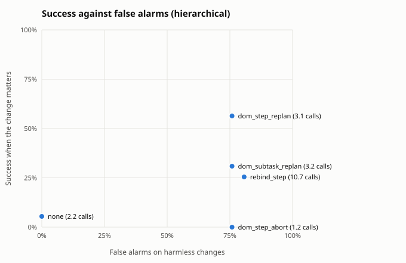
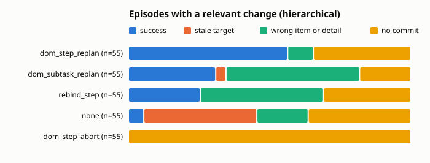

Built from 1025 scored episodes.

## Summary by guard

Relevant: the change moved or removed the target the planner saw. Harmless: no change, or one that leaves the target where it was. Fired: the guard re-planned, re-bound or aborted at least once. Calls: planner plus checker calls per episode.

| architecture | guard | relevant n | fired | success | stale | harmless n | success | false alarms | calls |
|---|---|---|---|---|---|---|---|---|---|
| hierarchical | dom_step_abort | 55 | 100% | 0% | 0% | 145 | 16% | 76% | 1.2 |
| hierarchical | dom_step_replan | 55 | 100% | 56% | 0% | 145 | 68% | 76% | 3.1 |
| hierarchical | none | 55 | 0% | 5% | 40% | 145 | 61% | 0% | 2.2 |
| hierarchical | rebind_step | 55 | 84% | 25% | 0% | 145 | 44% | 81% | 10.7 |
| hierarchical | dom_subtask_replan | 55 | 100% | 31% | 4% | 145 | 48% | 76% | 3.2 |

## By change kind

Success on each kind of change. When the change removed the target there is no correct item, so the column counts episodes that held off: no commit, or a guard abort.

| architecture | guard | no change | irrelevant | relevant | target removed: held off |
|---|---|---|---|---|---|
| hierarchical | dom_step_abort | 33% of 70 | 0% of 75 | 0% of 55 | 100% of 5 |
| hierarchical | dom_step_replan | 63% of 70 | 72% of 75 | 56% of 55 | 100% of 5 |
| hierarchical | none | 60% of 70 | 61% of 75 | 5% of 55 | 80% of 5 |
| hierarchical | rebind_step | 51% of 70 | 37% of 75 | 25% of 55 | 0% of 5 |
| hierarchical | dom_subtask_replan | 50% of 70 | 45% of 75 | 31% of 55 | 20% of 5 |

## Relevant changes by task

Success on episodes whose change moved the target, per task.

| architecture | guard | inbox relative | shop cheapest | shop highest_rated |
|---|---|---|---|---|
| hierarchical | dom_step_abort | 0% of 20 | 0% of 20 | 0% of 15 |
| hierarchical | dom_step_replan | 50% of 20 | 55% of 20 | 67% of 15 |
| hierarchical | none | 0% of 20 | 10% of 20 | 7% of 15 |
| hierarchical | rebind_step | 35% of 20 | 25% of 20 | 13% of 15 |
| hierarchical | dom_subtask_replan | 50% of 20 | 30% of 20 | 7% of 15 |

## Outcomes

| architecture | guard | domain | kind | change | n | success | stale | wrong_item | wrong_detail | aborted | no_commit | planner calls |
|---|---|---|---|---|---|---|---|---|---|---|---|---|
| hierarchical | none | inbox | fixed | irrelevant | 30 | 47% | 0% | 23% | 0% | 0% | 30% | 1.8 |
| hierarchical | none | inbox | fixed | none | 20 | 65% | 0% | 5% | 0% | 0% | 30% | 1.9 |
| hierarchical | none | inbox | relative | irrelevant | 10 | 50% | 0% | 0% | 0% | 0% | 50% | 1.9 |
| hierarchical | none | inbox | relative | none | 20 | 55% | 0% | 5% | 0% | 0% | 40% | 2.0 |
| hierarchical | none | inbox | relative | relevant | 20 | 0% | 55% | 0% | 0% | 0% | 45% | 2.1 |
| hierarchical | none | shop | cheapest | irrelevant | 5 | 20% | 0% | 60% | 0% | 0% | 20% | 2.4 |
| hierarchical | none | shop | cheapest | none | 10 | 20% | 0% | 10% | 0% | 0% | 70% | 1.6 |
| hierarchical | none | shop | cheapest | relevant | 20 | 10% | 15% | 40% | 0% | 0% | 35% | 2.1 |
| hierarchical | none | shop | fixed | irrelevant | 20 | 90% | 0% | 0% | 0% | 0% | 10% | 2.8 |
| hierarchical | none | shop | fixed | none | 10 | 80% | 0% | 0% | 0% | 0% | 20% | 2.5 |
| hierarchical | none | shop | fixed | target_removed | 5 | 0% | 0% | 20% | 0% | 0% | 80% | 1.2 |
| hierarchical | none | shop | highest_rated | irrelevant | 10 | 80% | 0% | 10% | 0% | 0% | 10% | 2.8 |
| hierarchical | none | shop | highest_rated | none | 10 | 80% | 0% | 10% | 0% | 0% | 10% | 2.8 |
| hierarchical | none | shop | highest_rated | relevant | 15 | 7% | 53% | 13% | 0% | 0% | 27% | 2.3 |
| hierarchical | dom_step_abort | inbox | fixed | irrelevant | 30 | 0% | 0% | 0% | 0% | 100% | 0% | 1.0 |
| hierarchical | dom_step_abort | inbox | fixed | none | 20 | 35% | 0% | 0% | 0% | 50% | 15% | 1.5 |
| hierarchical | dom_step_abort | inbox | relative | irrelevant | 10 | 0% | 0% | 0% | 0% | 100% | 0% | 1.0 |
| hierarchical | dom_step_abort | inbox | relative | none | 20 | 30% | 0% | 0% | 0% | 50% | 20% | 1.6 |
| hierarchical | dom_step_abort | inbox | relative | relevant | 20 | 0% | 0% | 0% | 0% | 100% | 0% | 1.0 |
| hierarchical | dom_step_abort | shop | cheapest | irrelevant | 5 | 0% | 0% | 0% | 0% | 100% | 0% | 1.0 |
| hierarchical | dom_step_abort | shop | cheapest | none | 10 | 10% | 0% | 20% | 0% | 50% | 20% | 1.6 |
| hierarchical | dom_step_abort | shop | cheapest | relevant | 20 | 0% | 0% | 0% | 0% | 100% | 0% | 1.0 |
| hierarchical | dom_step_abort | shop | fixed | irrelevant | 20 | 0% | 0% | 0% | 0% | 100% | 0% | 1.0 |
| hierarchical | dom_step_abort | shop | fixed | none | 10 | 50% | 0% | 0% | 0% | 50% | 0% | 2.0 |
| hierarchical | dom_step_abort | shop | fixed | target_removed | 5 | 0% | 0% | 0% | 0% | 100% | 0% | 1.0 |
| hierarchical | dom_step_abort | shop | highest_rated | irrelevant | 10 | 0% | 0% | 0% | 0% | 100% | 0% | 1.0 |
| hierarchical | dom_step_abort | shop | highest_rated | none | 10 | 40% | 0% | 10% | 0% | 50% | 0% | 2.0 |
| hierarchical | dom_step_abort | shop | highest_rated | relevant | 15 | 0% | 0% | 0% | 0% | 100% | 0% | 1.0 |
| hierarchical | dom_step_replan | inbox | fixed | irrelevant | 30 | 70% | 0% | 0% | 0% | 0% | 30% | 3.0 |
| hierarchical | dom_step_replan | inbox | fixed | none | 20 | 70% | 0% | 0% | 0% | 0% | 30% | 2.5 |
| hierarchical | dom_step_replan | inbox | relative | irrelevant | 10 | 50% | 0% | 0% | 0% | 0% | 50% | 3.1 |
| hierarchical | dom_step_replan | inbox | relative | none | 20 | 60% | 0% | 0% | 0% | 0% | 40% | 2.7 |
| hierarchical | dom_step_replan | inbox | relative | relevant | 20 | 50% | 0% | 0% | 0% | 0% | 50% | 3.0 |
| hierarchical | dom_step_replan | shop | cheapest | irrelevant | 5 | 40% | 0% | 20% | 0% | 0% | 40% | 3.2 |
| hierarchical | dom_step_replan | shop | cheapest | none | 10 | 30% | 0% | 30% | 0% | 0% | 40% | 2.4 |
| hierarchical | dom_step_replan | shop | cheapest | relevant | 20 | 55% | 0% | 15% | 0% | 0% | 30% | 3.3 |
| hierarchical | dom_step_replan | shop | fixed | irrelevant | 20 | 100% | 0% | 0% | 0% | 0% | 0% | 4.0 |
| hierarchical | dom_step_replan | shop | fixed | none | 10 | 90% | 0% | 0% | 0% | 0% | 10% | 3.3 |
| hierarchical | dom_step_replan | shop | fixed | target_removed | 5 | 0% | 0% | 0% | 0% | 0% | 100% | 2.0 |
| hierarchical | dom_step_replan | shop | highest_rated | irrelevant | 10 | 60% | 0% | 30% | 0% | 0% | 10% | 3.8 |
| hierarchical | dom_step_replan | shop | highest_rated | none | 10 | 60% | 0% | 10% | 0% | 0% | 30% | 2.9 |
| hierarchical | dom_step_replan | shop | highest_rated | relevant | 15 | 67% | 0% | 13% | 0% | 0% | 20% | 3.6 |
| hierarchical | dom_subtask_replan | inbox | fixed | irrelevant | 30 | 60% | 0% | 10% | 0% | 0% | 30% | 3.7 |
| hierarchical | dom_subtask_replan | inbox | fixed | none | 20 | 70% | 0% | 0% | 0% | 0% | 30% | 2.6 |
| hierarchical | dom_subtask_replan | inbox | relative | irrelevant | 10 | 50% | 0% | 0% | 0% | 0% | 50% | 3.6 |
| hierarchical | dom_subtask_replan | inbox | relative | none | 20 | 55% | 0% | 0% | 0% | 0% | 45% | 3.0 |
| hierarchical | dom_subtask_replan | inbox | relative | relevant | 20 | 50% | 0% | 0% | 0% | 0% | 50% | 4.0 |
| hierarchical | dom_subtask_replan | shop | cheapest | irrelevant | 5 | 0% | 0% | 100% | 0% | 0% | 0% | 2.8 |
| hierarchical | dom_subtask_replan | shop | cheapest | none | 10 | 10% | 0% | 60% | 0% | 0% | 30% | 2.5 |
| hierarchical | dom_subtask_replan | shop | cheapest | relevant | 20 | 30% | 10% | 60% | 0% | 0% | 0% | 2.9 |
| hierarchical | dom_subtask_replan | shop | fixed | irrelevant | 20 | 35% | 0% | 65% | 0% | 0% | 0% | 3.3 |
| hierarchical | dom_subtask_replan | shop | fixed | none | 10 | 50% | 0% | 50% | 0% | 0% | 0% | 3.6 |
| hierarchical | dom_subtask_replan | shop | fixed | target_removed | 5 | 0% | 0% | 80% | 0% | 0% | 20% | 3.6 |
| hierarchical | dom_subtask_replan | shop | highest_rated | irrelevant | 10 | 40% | 0% | 60% | 0% | 0% | 0% | 2.9 |
| hierarchical | dom_subtask_replan | shop | highest_rated | none | 10 | 40% | 0% | 60% | 0% | 0% | 0% | 3.1 |
| hierarchical | dom_subtask_replan | shop | highest_rated | relevant | 15 | 7% | 0% | 93% | 0% | 0% | 0% | 2.9 |
| hierarchical | rebind_step | inbox | fixed | irrelevant | 30 | 53% | 0% | 17% | 0% | 0% | 30% | 3.7 |
| hierarchical | rebind_step | inbox | fixed | none | 20 | 75% | 0% | 0% | 0% | 0% | 25% | 2.5 |
| hierarchical | rebind_step | inbox | relative | irrelevant | 10 | 40% | 0% | 10% | 0% | 0% | 50% | 2.9 |
| hierarchical | rebind_step | inbox | relative | none | 20 | 45% | 0% | 5% | 0% | 0% | 50% | 2.2 |
| hierarchical | rebind_step | inbox | relative | relevant | 20 | 35% | 0% | 15% | 0% | 0% | 50% | 2.9 |
| hierarchical | rebind_step | shop | cheapest | irrelevant | 5 | 0% | 0% | 100% | 0% | 0% | 0% | 2.4 |
| hierarchical | rebind_step | shop | cheapest | none | 10 | 20% | 0% | 50% | 0% | 0% | 30% | 2.3 |
| hierarchical | rebind_step | shop | cheapest | relevant | 20 | 25% | 0% | 60% | 0% | 0% | 15% | 2.5 |
| hierarchical | rebind_step | shop | fixed | irrelevant | 20 | 25% | 0% | 60% | 0% | 0% | 15% | 2.5 |
| hierarchical | rebind_step | shop | fixed | none | 10 | 50% | 0% | 50% | 0% | 0% | 0% | 2.5 |
| hierarchical | rebind_step | shop | fixed | target_removed | 5 | 0% | 0% | 100% | 0% | 0% | 0% | 3.0 |
| hierarchical | rebind_step | shop | highest_rated | irrelevant | 10 | 30% | 0% | 60% | 0% | 0% | 10% | 2.3 |
| hierarchical | rebind_step | shop | highest_rated | none | 10 | 50% | 0% | 20% | 0% | 0% | 30% | 1.9 |
| hierarchical | rebind_step | shop | highest_rated | relevant | 15 | 13% | 0% | 60% | 0% | 0% | 27% | 2.1 |

## Cost per episode

Means per episode. Model seconds add up the latency of every model call, so they include time spent waiting in a shared server's batch; compare them within one run set only.

| architecture | guard | planner calls | checker calls | executor calls | model seconds | actions |
|---|---|---|---|---|---|---|
| hierarchical | dom_step_abort | 1.2 | 0.0 | 2.0 | 26.8 | 1.0 |
| hierarchical | dom_step_replan | 3.1 | 0.0 | 8.3 | 94.2 | 6.2 |
| hierarchical | none | 2.2 | 0.0 | 8.4 | 85.5 | 7.2 |
| hierarchical | rebind_step | 2.6 | 8.1 | 9.8 | 141.0 | 8.7 |
| hierarchical | dom_subtask_replan | 3.2 | 0.0 | 7.9 | 90.3 | 6.5 |

## False alarms on harmless changes

| architecture | guard | harmless episodes | false alarm rate | planner calls |
|---|---|---|---|---|
| hierarchical | dom_step_abort | 145 | 76% | 1.2 |
| hierarchical | dom_step_replan | 145 | 76% | 3.1 |
| hierarchical | none | 145 | 0% | 2.2 |
| hierarchical | rebind_step | 145 | 81% | 2.6 |
| hierarchical | dom_subtask_replan | 145 | 76% | 3.2 |

## Paired against `none` on relevant changes

Same scenarios in both arms. Difference is the guard's success rate minus the baseline's, with a 95% bootstrap interval over scenario templates (10000 resamples, seed 0) and an exact McNemar test on the discordant pairs.

| architecture | guard | domain | pairs | none | guard | difference | 95% CI | only guard vs only baseline succeeded | McNemar |
|---|---|---|---|---|---|---|---|---|---|
| hierarchical | dom_step_abort | inbox | 20 | 0% | 0% | +0 pts | [+0, +0] | 0 vs 0 | p = 1.000 |
| hierarchical | dom_step_abort | shop | 35 | 9% | 0% | -9 pts | [-17, +0] | 0 vs 3 | p = 0.250 |
| hierarchical | dom_step_abort | all | 55 | 5% | 0% | -5 pts | [-11, +0] | 0 vs 3 | p = 0.250 |
| hierarchical | dom_step_replan | inbox | 20 | 0% | 50% | +50 pts | [+20, +80] | 10 vs 0 | p = 0.002 |
| hierarchical | dom_step_replan | shop | 35 | 9% | 60% | +51 pts | [+32, +71] | 20 vs 2 | p < 0.001 |
| hierarchical | dom_step_replan | all | 55 | 5% | 56% | +51 pts | [+34, +68] | 30 vs 2 | p < 0.001 |
| hierarchical | rebind_step | inbox | 20 | 0% | 35% | +35 pts | [+10, +60] | 7 vs 0 | p = 0.016 |
| hierarchical | rebind_step | shop | 35 | 9% | 20% | +11 pts | [+3, +20] | 4 vs 0 | p = 0.125 |
| hierarchical | rebind_step | all | 55 | 5% | 25% | +20 pts | [+10, +33] | 11 vs 0 | p < 0.001 |
| hierarchical | dom_subtask_replan | inbox | 20 | 0% | 50% | +50 pts | [+20, +80] | 10 vs 0 | p = 0.002 |
| hierarchical | dom_subtask_replan | shop | 35 | 9% | 20% | +11 pts | [+3, +19] | 4 vs 0 | p = 0.125 |
| hierarchical | dom_subtask_replan | all | 55 | 5% | 31% | +25 pts | [+12, +42] | 14 vs 0 | p < 0.001 |
